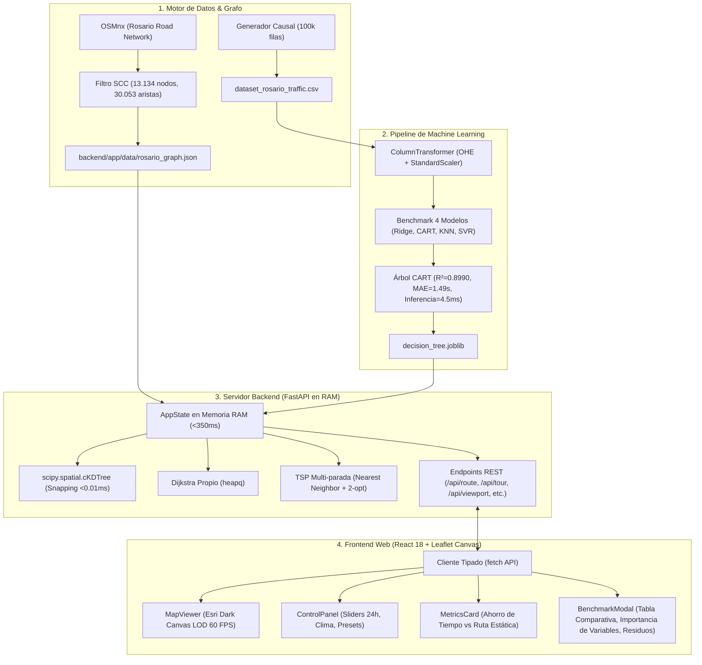

# 🚗 Ruteo de Última Milla con Predicción de Demanda en la Red Vial de Rosario

[](https://fastapi.tiangolo.com)
[](https://react.dev)
[](https://vitejs.dev)
[](https://tailwindcss.com)
[](https://leafletjs.com)
[](https://python.org)
[](https://scikit-learn.org)
[]()

**Trabajo Práctico Integrador**  
**Asignatura:** Lógica y Teoría de Grafos  
**Problema Seleccionado:** Problema 1 – Ruteo de Última Milla con Predicción de Demanda  
**Ciudad de Aplicación:** Rosario, Santa Fe, Argentina  
**Autores:** Leandro Caraballo & Facundo Naveira  

---

## 📋 Resumen del Proyecto

Los sistemas de ruteo vehicular convencionales suelen calcular caminos mínimos considerando distancias físicas invariantes en metros. En una metrópolis como Rosario, la distancia física correlaciona de manera imperfecta con el tiempo real de viaje, dado que este último depende de **factores dinámicos y meteorológicos** (horarios pico escolares/laborales, lluvia torrencial, carácter hábil o feriado, y cuellos de botella por jerarquía vial).

Este proyecto implementa una solución integral de extremo a extremo:
1. **Topología Vial Real:** Grafo dirigido fuertemente conexo (SCC) de **13.134 intersecciones** y **30.053 tramos de calle** extraído de OpenStreetMap (OSMnx).
2. **Dataset Causal Realista:** $100.000$ viajes sintéticos con modelado físico de semáforos, lluvia y efecto bimodal de congestión.
3. **Machine Learning Supervisado:** Benchmark riguroso sobre partición $80/20$ sin fuga de datos evaluando 4 familias de modelos (Ridge, CART, KNN, SVR). El **Árbol de Decisión CART** (`max_depth=16`, `min_samples_leaf=10`) fue seleccionado para producción con **$R^2 = 0.8990$**, **$\text{MAE} = 1.49\text{ s}$** y capacidad de inferir las 30.053 aristas en **$4.57\text{ ms}$**.
4. **Teoría de Grafos:** Algoritmo artesanal de **Dijkstra con cola de prioridad binaria (`heapq`)** para caminos mínimos dinámicos ponderados por IA (validado contra NetworkX) y optimizador de rondas de paquetería multipunto (**TSP** con *Nearest Neighbor* + *2-opt* adaptado a grafos dirigidos).
5. **Plataforma Web Interactiva:** Backend asincrónico en **FastAPI** con precarga en RAM (<0.35 s de arranque) y frontend en **React 18, TypeScript, Tailwind CSS y Leaflet Canvas**, con mapa Esri Dark, carga progresiva por viewport (LOD), ruta showcase zero-click, atajos de demo en 1 clic y modal científico de auditoría ML.

---

## 🏛️ Arquitectura del Sistema



---

## 🛠️ Prerrequisitos

Asegúrate de contar con las siguientes herramientas instaladas en tu sistema (Linux / WSL / macOS / Windows):

- **Python 3.12+** (con `pip` y soporte de entornos virtuales `venv`).
- **Node.js 20+** (LTS recomendado).
- **pnpm 9+** (recomendado: `npm install -g pnpm` o vía corepack). Alternativamente se puede usar `npm`.

---

## 🚀 Instalación Rápida Paso a Paso

### 1. Clonar el Repositorio
```bash
git clone https://github.com/leancarr/TP-MachineLearning-y-Grafos--Problema-1.git
cd TP-MachineLearning-y-Grafos--Problema-1
git checkout develop
```

### 2. Configuración del Backend (Python)

```bash
# Crear y activar entorno virtual
python3 -m venv .venv
source .venv/bin/activate       # En Linux/WSL/macOS
# .venv\Scripts\activate       # En Windows PowerShell

# Instalar dependencias de Python
pip install --upgrade pip
pip install -r requirements.txt
```

*(Opcional: Si deseas ajustar variables de entorno, copia `.env.example` a `.env`)*:
```bash
cp .env.example .env
```

### 3. Configuración del Frontend (React + Vite)

```bash
cd frontend
pnpm install
# pnpm approve-builds  (si pnpm lo solicita para compilar esbuild)
cd ..
```

---

## 💻 Ejecución del Proyecto en Desarrollo

Para levantar el sistema completo se requieren **dos terminales**:

### Terminal 1: Backend FastAPI (Puerto 8000)
```bash
source .venv/bin/activate
uvicorn backend.app.main:app --host 0.0.0.0 --port 8000 --reload
```
- **API URL:** `http://localhost:8000`
- **Documentación Interactiva (Swagger/OpenAPI):** `http://localhost:8000/docs`
- **Especificación Redoc:** `http://localhost:8000/redoc`

El backend inicializa en memoria RAM la topología completa de Rosario, los índices espaciales y el árbol de decisión en menos de **350 milisegundos**.

### Terminal 2: Frontend Vite (Puerto 5173)
```bash
cd frontend
pnpm dev
```
- **Aplicación Web:** `http://localhost:5173`

Al abrir la página, el sistema carga de forma predeterminada la **Ruta Showcase Zero-Click** (*Pellegrini ➔ Monumento a la Bandera* en hora pico con lluvia), exhibiendo de inmediato la bifurcación de rutas y el ahorro del **~30%** conseguido por la IA.

---

## 🧪 Ejecución de Suites de Pruebas

El proyecto cuenta con un estándar riguroso de calidad respaldado por **90 tests automatizados**:

### 1. Tests del Backend (59 pruebas en Pytest)
```bash
source .venv/bin/activate
pytest
```
*Cubre: Grafo SCC, determinismo del generador 100k, sanity check sin NaNs ni velocidades irreales, ausencia de data leakage en el preprocesador, modelos comparativos (Ridge, Árbol, KNN, SVR), validación cruzada de Dijkstra contra NetworkX en 50 pares aleatorios, optimización TSP 2-opt y suite completa de endpoints FastAPI.*

### 2. Tests del Frontend (31 pruebas en Vitest + Tipado Estricto)
```bash
cd frontend

# Chequeo de tipado estricto (0 errores)
pnpm run typecheck

# Suite de tests unitarios y de componentes
pnpm test

# Compilación de producción
pnpm run build
```
*Cubre: MapViewer con Canvas LOD, ControlPanel contextual, MetricsCard, StopsManager multiparada, CongestionMonitor top 10, StreetSearch con autocompletado y BenchmarkModal con accesibilidad y diagnóstico de residuos.*

### 3. Smoke Test de Integración End-to-End en Vivo
Se provee un script que levanta el cliente completo y valida en 2 segundos todos los contratos HTTP y tiempos de respuesta:
```bash
source .venv/bin/activate
python3 scripts/e2e_smoke_test.py
```

---

## 📊 Benchmark Oficial de Machine Learning

Resumen de métricas evaluadas sobre el conjunto de test independiente ($20.000$ muestras sin fuga de información):

| Modelo | $R^2$ Score | MAE (segundos) | RMSE (segundos) | Latencia 30k Aristas | Decisión Técnica |
| :--- | :---: | :---: | :---: | :---: | :--- |
| **Árbol de Decisión CART (Producción)** | **$0.8990$** | **$1.49\text{ s}$** | **$4.16\text{ s}$** | **$4.57\text{ ms}$** | **Seleccionado:** Captura no linealidades horarias y climáticas sin cuello de botella. |
| **Regresión Lineal Ridge (Baseline)** | $0.7709$ | $2.93\text{ s}$ | $6.26\text{ s}$ | $1.52\text{ ms}$ | **Descartado:** Incapaz de modelar la bimodalidad del tráfico pico. |
| **K-Nearest Neighbors (KNN)** | $0.7809$ | $2.42\text{ s}$ | $5.72\text{ s}$ | $\sim 7.90\text{ s}$ | **Descartado:** Inviable para ruteo web en tiempo real por complejidad $O(N)$ en inferencia. |
| **Support Vector Regressor (SVR)** | $0.6997$ | $2.15\text{ s}$ | $6.69\text{ s}$ | $\sim 14.80\text{ s}$ | **Descartado:** Inadecuado para 100k filas por costo de entrenamiento cuadrático $O(N^2)$. |

### Diagnóstico de Residuos del Modelo en Producción
- **Error Medio (Sesgo):** $-0.037\text{ s}$ (distribución gaussiana centrada en cero, sin sesgo sistemático).
- **Desvío Estándar del Error:** $\pm 4.156\text{ s}$.
- **Percentil 95 (P95):** $4.53\text{ s}$ de error máximo en el 95% de los viajes urbanos.
- **Overfitting Gap ($R^2_{\text{test}} - R^2_{\text{train}}$):** Apenas $0.0055$, demostrando óptima capacidad de generalización.

---

## 🗺️ Guía de Demostración para la Defensa Oral

Al presentar el proyecto, se recomienda seguir estos **3 pasos clave**:

1. **Ruta Showcase de Bienvenida (Zero-Click):**
   - Nada más abrir la aplicación, señalar la Av. Pellegrini encendida en rojo vivo.
   - Mostrar la **Ruta Estática (Azul punteada)** que insiste en meterse por Pellegrini demorando $25.7\text{ min}$ frente a la **Ruta IA (Verde sólida)** que se desvía por calles secundarias despejadas demorando $18.0\text{ min}$ (**Ahorro: 7.7 min / 30%**).
2. **Atajos de Demostración en 1 Clic:**
   - Hacer clic en *"Circunvalación ➔ Centro"* para ilustrar cómo el modelo aprovecha la alta velocidad de la autopista perimetral.
   - Hacer clic en *"Reparto 4 Clientes (TSP)"* para ver la heurística 2-opt reordenando los pedidos de forma óptima para minimizar la suma total de tiempos de viaje.
3. **Auditoría Científica:**
   - Presionar el botón **"Auditoría ML"** en la barra superior.
   - Mostrar la tabla comparativa con las 4 familias de modelos, el gráfico de **Importancia de Variables** (liderado por la longitud del tramo con 76%, clima de tormenta con 5.5% y hora del día con 4%) y los hiperparámetros anti-sobreajuste.

---

## 📡 Referencia de Endpoints de la API REST

| Método | Endpoint | Descripción |
| :--- | :--- | :--- |
| `GET` | `/api/presets` | Lista los 5 escenarios contextuales precargados (Madrugada, Pico Mañana, Mediodía Lluvioso, Pico Tormenta, Domingo Feriado). |
| `GET` | `/api/metrics` | Métricas consolidadas del benchmark, análisis de residuos e importancia de variables del árbol CART. |
| `GET` | `/api/nodes/nearest?lat=...&lon=...` | Snapping espacial ultrarrápido ($<0.01\text{ ms}$) a la esquina más cercana mediante `scipy.spatial.cKDTree`. |
| `GET` | `/api/nodes/search?q=...&limit=...` | Búsqueda por texto y autocompletado de intersecciones y avenidas de Rosario. |
| `POST` | `/api/graph/viewport` | Filtro vectorial por Bounding Box y LOD por zoom para renderizar en Leaflet Canvas. |
| `POST` | `/api/graph/congested?limit=...` | Ranking en tiempo real de las arterias más colapsadas bajo el contexto horario y meteorológico actual. |
| `POST` | `/api/route` | Cálculo dual simultáneo de camino mínimo estático (por distancia) vs. dinámico (Dijkstra ponderado por predicción ML). |
| `POST` | `/api/tour` | Optimización de ronda de paquetería multiparada (TSP con *Nearest Neighbor* + búsqueda local *2-opt*). |

---

## 📄 Documentación Complementaria

- [`docs/informe.md`](docs/informe.md): Informe académico completo (438 líneas) con formulación matemática, diseño algorítmico, evaluación experimental detallada y sección de reflexión ética sobre el Uso de IA.

---

## 👥 Autores y Contacto

- **Facundo Naveira**
- **Leandro Caraballo**

*Trabajo realizado para la carrera de Ingeniería / Ciencias de la Computación — Noviembre de 2026.*
