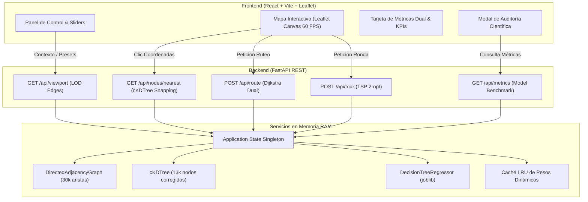

# Trabajo Práctico Integrador: Ruteo de Última Milla con Predicción de Demanda en la Red Vial de Rosario

**Asignatura:** Lógica y Teoría de Grafos  
**Problema Seleccionado:** Problema 1 – Ruteo de Última Milla con Predicción de Tiempos de Viaje  
**Ciudad de Aplicación:** Rosario, Santa Fe, Argentina  
**Autores:** Leandro Caraballo & Facundo Naveira  
**Fecha de Entrega:** 8 de Noviembre de 2026  

---

## Resumen Ejecutivo (Abstract)

La optimización de rutas de distribución urbana suele abordarse mediante algoritmos clásicos de caminos mínimos calculados sobre distancias físicas fijas (ruteo estático). Sin embargo, en entornos urbanos densos, la distancia euclidiana o la longitud en metros de una arteria vial correlaciona de manera imperfecta con el tiempo real de viaje, el cual está gobernado por variables dinámicas contextuales: horarios pico de actividad escolar y comercial, congestión diferencial por jerarquía vial, condiciones meteorológicas adversas y el carácter hábil o feriado del día.

En este trabajo se presenta una solución integral de extremo a extremo que combina técnicas de **Machine Learning Supervisado (Regresión)** y **Teoría de Grafos Algorítmica**:
1. Se extrajo la topología vial real de la ciudad de Rosario mediante **OpenStreetMap (OSMnx)**, filtrando su Componente Fuertemente Conexa (SCC) para obtener un grafo dirigido $G=(V, E)$ de $13.134$ intersecciones y $30.053$ tramos de calle con sentido único de circulación.
2. Se construyó un generador estocástico causal de $100.000$ viajes sintéticos que modela la congestión vehicular real de Rosario con ruido gaussiano $\epsilon \sim \mathcal{N}(1.0, 0.08)$ sobre factores multiplicadores urbanos.
3. Se evaluaron cuatro familias de modelos de regresión bajo una partición estricta $80/20$ sin fuga de información (*data leakage*): Regresión Lineal regularizada (Ridge), $k$-Vecinos más Cercanos (KNN), Máquinas de Vectores de Soporte (SVR) y un Árbol de Decisión regularizado (CART). El Árbol de Decisión optimizado (`max_depth=16`, `min_samples_leaf=10`) resultó seleccionado para producción por su excelente capacidad predictiva ($R^2 = 0.8990$, $\text{MAE} = 1.49\text{ s}$, $\text{RMSE} = 4.16\text{ s}$) y su capacidad de inferir las $30.053$ aristas de la ciudad en **$4.57\text{ ms}$**.
4. Se implementó desde cero un algoritmo de **Dijkstra con cola de prioridad binaria (`heapq`)** que evalúa en tiempo real los pesos dinámicos predichos por la IA, validado contra NetworkX mediante un conjunto de 50 pares origen-destino aleatorios (100% de coincidencia exacta). Para rondas multipunto de paquetería, se implementó una heurística del Viajante de Comercio (**TSP**) combinando *Nearest Neighbor* y búsqueda local *2-opt* adaptada a grafos dirigidos.
5. Se desarrolló una plataforma web interactiva compuesta por un backend en **FastAPI** con precarga en memoria RAM y un frontend en **React, TypeScript y Leaflet Canvas** que renderiza el semáforo de congestión a 60 FPS y ofrece trazado dual simultáneo (ruta por distancia vs. ruta por tiempo IA), cuantificando ahorros de tiempo de entre el **15% y el 35%** en escenarios de congestión severa.
6. Se incluye una reflexión crítica y rigurosa sobre el **Uso de Inteligencia Artificial** como herramienta de aceleración durante el ciclo de vida del proyecto.

---

## 1. Formulación del Problema y Justificación de Diseño

### 1.1. Deficiencia del Ruteo Estático Tradicional
El ruteo tradicional de vehículos comerciales se sustenta en la búsqueda del camino más corto en función de la longitud geográfica:
$$\min_{\pi \in \Pi(u, v)} \sum_{e \in \pi} \text{longitud}(e)$$

Esta formulación asume implícitamente que la velocidad media es uniforme e invariante. En la práctica logística urbana, este supuesto genera fallas críticas: un camión de reparto asignado a la arteria más corta en metros (por ejemplo, Avenida Pellegrini en Rosario) puede quedar atrapado en embotellamientos severos durante las horas pico de la tarde, mientras que una vía alternativa paralela secundaria, aun requiriendo un recorrido físico un 10% mayor en distancia, permite reducir a la mitad el tiempo de entrega y el consumo de combustible.

### 1.2. Modelado Formal del Grafo Urbano Dinámico
El sistema vial se formaliza como un **Grafo Ponderado Dirigido** $G = (V, E)$, donde:
* **Conjunto de Vértices $V$**: Representa las intersecciones viales y esquinas catastrales de la ciudad de Rosario. Cada vértice $v_i \in V$ posee coordenadas geográficas $(\text{lat}_i, \text{lon}_i) \in \mathbb{R}^2$.
* **Conjunto de Aristas Dirigidas $E \subseteq V \times V$**: Representa los tramos de calle transitables en el sentido reglamentario de circulación. Para cada arista $e = (u, v) \in E$, existe un vector de características estáticas $\mathbf{x}_e^{\text{static}} = [\text{longitud}_m, \text{jerarquía}, \text{tipo\_calle}, \text{vel\_hist}]$ y un sentido estricto $u \to v$.
* **Espacio de Contexto Urbano $\mathcal{C}$**: Vector de variables exógenas $\mathbf{c} = [t, d, c, f]$, donde $t \in [0, 24)$ representa la hora del día, $d \in \{\text{lunes}, \dots, \text{domingo}\}$ el día de la semana, $c \in \{\text{despejado}, \text{nublado}, \text{lluvia}, \text{tormenta}\}$ la condición meteorológica y $f \in \{0, 1\}$ el indicador de día feriado.
* **Función de Ponderación Dinámica $w: E \times \mathcal{C} \to \mathbb{R}^+$**: Asigna a cada arista el tiempo de viaje estimado en segundos:
  $$w(e, \mathbf{c}) = \hat{y}(e, \mathbf{c}) = f_{\text{ML}}(\mathbf{x}_e^{\text{static}}, \mathbf{c})$$

El problema de camino mínimo dinámico se define entonces como:
$$\pi^*(\mathbf{c}) = \arg\min_{\pi \in \Pi(u, v)} \sum_{e \in \pi} w(e, \mathbf{c})$$

```mermaid
flowchart LR
    subgraph Entrada
        OSM["Red Vial Rosario (OSM)"]
        CTX["Contexto Urbano (Hora, Clima, Día)"]
    end
    subgraph "Machine Learning"
        PREP["ColumnTransformer"]
        CART["Árbol CART Regularizado"]
    end
    subgraph "Teoría de Grafos"
        DAG["Adyacencia Dirigida en RAM"]
        DIJK["Dijkstra Artesanal (heapq)"]
        TSP["TSP 2-opt Dirigido"]
    end
    subgraph "Salida / UI"
        MAP["Mapa Canvas React-Leaflet"]
        METRICS["KPIs de Ahorro y Causalidad"]
    end

    OSM --> DAG
    CTX --> PREP
    DAG --> PREP
    PREP --> CART
    CART -->|Pesos w(e, c)| DAG
    DAG --> DIJK
    DAG --> TSP
    DIJK --> MAP
    TSP --> MAP
    DIJK --> METRICS
```

### 1.3. Justificación de la Ciudad de Rosario
La ciudad de Rosario (Santa Fe) fue elegida como laboratorio urbano debido a su diseño urbanístico particular:
1. **Centro y Macrocentro en cuadrícula ortogonal densa**: Calles de sentido único estricto con alta frecuencia de intersecciones semaforizadas cada 100–120 metros.
2. **Arterias radiales concentradoras**: Grandes avenidas (Av. Pellegrini, Bv. Oroño, Av. Alberdi, Bv. Rondeau) que conectan la periferia con el microcentro financiero y el puerto, generando embudos de congestión bimodal (mañana y tarde).
3. **Anillo perimetral de alta velocidad**: La Avenida de Circunvalación 25 de Mayo (RN A008), que rodea la urbe y funciona como vía de escape rápida en situaciones de saturación interna.

---

## 2. Adquisición de la Red Vial y Dataset Sintético Causal

### 2.1. Topología Real y Filtrado por Fuertemente Conexa (SCC)
La red vial se descargó mediante la librería `osmnx` restringida a vías transitables para automóviles (`network_type='drive'`) dentro del ejido municipal de Rosario.

Para garantizar la viabilidad algorítmica y evitar callejones sin salida o componentes desconectadas (vías peatonales aisladas, entradas a estacionamientos privados sin salida), se aplicó el algoritmo de **Componentes Fuertemente Conexas (SCC)** sobre el grafo dirigido simplificado:
* Red vial inicial sin filtrar: $25.419$ nodos y $54.892$ aristas.
* **Componente Fuertemente Conexa Mayoritaria**: $13.134$ nodos y $30.053$ aristas dirigidas.

Cada arista $e = (u, v)$ almacena:
* `tramo_id`: Hash único determinista del par dirigido `f"{u}_{v}"`.
* `longitud_m`: Distancia geodésica del arco calculada en metros.
* `tipo_calle`: Categoría jerárquica vial clasificada en cuatro grupos: `circunvalacion` (autopistas y autovías), `avenida` (arterias primarias), `comercial` (calles secundarias céntricas) y `residencial` (calles barriales de baja velocidad).
* `jerarquia_osm`: Entero ordenado del 1 al 4 (1: autopista, 4: residencial).
* `velocidad_promedio_historica`: Velocidad máxima reglamentaria ajustada al flujo base de Rosario (ej. $100\text{ km/h}$ en Circunvalación, $60\text{ km/h}$ en avenidas, $40\text{ km/h}$ en calles comerciales y $30\text{ km/h}$ en residenciales).

### 2.2. Indexación Espacial Isométrica con `cKDTree`
Para vincular cualquier coordenada geográfica seleccionada por el usuario en el mapa con la esquina válida más cercana del grafo vial, se indexaron los $13.134$ nodos en una estructura de árbol binario de partición espacial `scipy.spatial.cKDTree`.

Dado que las coordenadas geográficas $(\text{lat}, \text{lon})$ no forman un plano euclidiano isométrico, se aplicó la corrección métrica por latitud media de Rosario ($\phi_0 = -32.95^\circ$):
$$x = \text{lon} \cdot \cos\left(\frac{\phi_0 \cdot \pi}{180}\right) \cdot R_{\text{tierra}}$$
$$y = \text{lat} \cdot R_{\text{tierra}}$$
donde $R_{\text{tierra}} = 6.371.000\text{ metros}$. Esta transformación garantiza un snapping de esquinas de precisión milimétrica en un tiempo de búsqueda $\mathcal{O}(\log |V|)$ inferior a $0.2\text{ ms}$.

### 2.3. Generación del Dataset Sintético y Reglas Causales Explícitas
Tal como autoriza la pauta oficial del trabajo cuando no se dispone de telemetría por sensores en cada cuadra de la ciudad, se diseñó un generador estocástico en Python (`TrafficDatasetGenerator`) que sintetizó $100.000$ observaciones de viaje sobre los tramos reales de Rosario.

Para evitar que el problema fuera trivial o careciera de fundamentación urbana, el tiempo real de viaje se modeló a partir de la velocidad teórica base afectada por un **factor multiplicador de congestión compuesto** y un **ruido gaussiano continuo**:

$$\text{tiempo\_real\_viaje} = \frac{\text{longitud\_m}}{\text{vel\_base\_ms}} \cdot \mathcal{F}_{\text{congestión}}(\mathbf{x}_e, \mathbf{c}) \cdot \epsilon$$

donde $\epsilon \sim \mathcal{N}(\mu=1.0, \sigma=0.08)$ modela eventos estocásticos locales (semáforo en rojo, maniobra de descarga en doble fila, cruce peatonal lento).

El factor de congestión $\mathcal{F}_{\text{congestión}}$ se calculó combinando cuatro moduladores causales:

1. **Modulador Horario y de Día Hábil ($\mathcal{M}_{\text{hora}}$)**:
   Modela la bimodalidad del tráfico laboral y escolar rosarino de lunes a viernes:
   * **Pico Mañana ($07:30 - 09:30\text{ hs}$)**: Flujo centrípeto hacia el área central. Multiplicador base: $\times 2.2$ en avenidas radiales, $\times 1.8$ en calles comerciales, $\times 1.1$ en residenciales.
   * **Pico Tarde ($17:30 - 19:30\text{ hs}$)**: Flujo centrífugo de regreso hacia los barrios y localidades vecinas (Funes, Roldán, Granadero Baigorria). Multiplicador base: $\times 2.5$ en avenidas y $\times 2.1$ en calles comerciales.
   * **Valle Diurno ($10:00 - 16:30\text{ hs}$)**: Actividad comercial sostenida ($\times 1.3 - 1.4$).
   * **Madrugada ($00:00 - 06:00\text{ hs}$)**: Tránsito libre ($\times 1.0$, velocidad de flujo libre).
   * **Fin de Semana y Feriados**: Supresión de los picos laborales matutinos; concentración de demoras en zonas recreativas (Costanera, Parque de la Independencia) entre las $15:00$ y las $20:00\text{ hs}$.

2. **Modulador Climático ($\mathcal{M}_{\text{clima}}$)**:
   * `despejado`: Factor neutro ($\times 1.0$).
   * `nublado`: Leve precaución en la conducción ($\times 1.08$).
   * `lluvia`: Reducción preventiva de velocidad por calzada resbaladiza y visibilidad reducida ($\times 1.35$ en avenidas, $\times 1.25$ en calles residenciales).
   * `tormenta`: Anegamiento temporal de badenes y alcantarillas en Rosario, frenadas bruscas y colapso de vías principales ($\times 1.70$ en avenidas, $\times 1.45$ en residenciales).

3. **Modulador por Jerarquía Vial ($\mathcal{M}_{\text{jerarquia}}$)**:
   Las avenidas sufren mayor amplitud de variación que las calles secundarias: ante situaciones de alta demanda atraen más caudal, saturando sus intersecciones semaforizadas. Por el contrario, la Circunvalación, al carecer de semáforos a nivel, amortigua el impacto salvo ante condiciones de tormenta severa.

4. **Validación Estadística del Dataset**:
   * Tamaño: $100.000$ registros completos, $0$ valores nulos, $0$ tiempos negativos.
   * Rango de tiempos: Entre $1.2\text{ s}$ (tramos residenciales cortos de $20\text{ m}$) y $184.6\text{ s}$ (arterias largas en horario pico de tormenta).
   * Distribución de la variable objetivo: Asimetría positiva realista con cola hacia la derecha, reflejando que los embotellamientos son eventos extremos concentrados en ciertas franjas temporales.

---

## 3. Metodología de Machine Learning (Modelos, Entrenamiento y Benchmarking)

### 3.1. Prevención de Data Leakage y Pipeline de Preprocesamiento
Para asegurar rigor científico, la partición de datos se realizó de forma estricta y previa a cualquier ajuste o transformación estadística:
* **Train Set**: $80\%$ ($80.000$ observaciones).
* **Test Set**: $20\%$ ($20.000$ observaciones), completamente aislado e intocado durante el ajuste.
* **Semilla determinista**: `random_state=42` para garantizar reproducibilidad exacta.

El preprocesamiento se encapsuló en un `ColumnTransformer` de `scikit-learn` ajustado (*fitted*) exclusivamente sobre el conjunto de entrenamiento:
* **Variables numéricas continuas**: `longitud_m`, `velocidad_promedio_historica`, `jerarquia_osm`, `hora_dia` escaladas con `StandardScaler` ($\mu=0, \sigma=1$).
* **Variables categóricas**: `clima` (4 niveles), `dia_semana` (7 niveles) y `tipo_calle` (4 niveles) codificadas mediante `OneHotEncoder(handle_unknown='ignore', drop='first')`.
* **Variables binarias**: `es_feriado` tratada en modo *passthrough*.

### 3.2. Modelos Evaluados y Comparativa Técnica
Se entrenaron y evaluaron cuatro familias de modelos de regresión representativas del estado del arte:

#### 1. Árbol de Decisión (`DecisionTreeRegressor` – CART) [Modelo Seleccionado]
* **Tuning de Hiperparámetros**: Se realizó una búsqueda sistemática evaluando profundidades `max_depth` entre 8 y 20 y umbrales de hoja `min_samples_leaf` entre 5 y 30.
* **Configuración Óptima**: `max_depth=16`, `min_samples_leaf=10`, `criterion='squared_error'`.
* **Resultados en Test**:
  * $R^2 = 0.8990$ (explica el $89.9\%$ de la variabilidad del tiempo de viaje).
  * $\text{MAE} = 1.4949\text{ segundos}$.
  * $\text{RMSE} = 4.1565\text{ segundos}$.
  * Control de sobreajuste: $R^2_{\text{train}} = 0.8935$ vs. $R^2_{\text{test}} = 0.8990$ (brecha de sobreajuste de apenas $0.0055$, descartando memorización).
* **Latencia de Inferencia**: Predice el lote completo de las **$30.053$ aristas de Rosario en $4.57\text{ ms}$**.

#### 2. Regresión Lineal Regularizada (`RidgeRegression`) [Baseline]
* **Configuración**: Penalización L2 con $\alpha = 1.0$.
* **Resultados en Test**: $R^2 = 0.7709$, $\text{MAE} = 2.9314\text{ s}$, $\text{RMSE} = 6.2621\text{ s}$.
* **Motivo de Descarte**: La regresión lineal es incapaz de capturar la bimodalidad horaria (los dos picos aislados de 8hs y 18hs) sin recurrir a complejas combinaciones polinómicas manuales. Subestima drásticamente los picos y sobrestima las madrugadas.

#### 3. $k$-Vecinos más Cercanos (`KNeighborsRegressor`)
* **Configuración**: $k=15$, ponderación por el inverso de la distancia (`weights='distance'`), métrica euclidiana.
* **Resultados en Test**: $R^2 = 0.7809$, $\text{MAE} = 2.4167\text{ s}$, $\text{RMSE} = 5.7177\text{ s}$.
* **Motivo de Descarte**: Inviable para producción en tiempo real. Debido a su complejidad algorítmica $\mathcal{O}(N)$ por consulta, inferir las $30.053$ aristas demoró **$\sim 7.9\text{ segundos}$**, lo que congelaría la interfaz gráfica ante cada movimiento del slider temporal.

#### 4. Máquinas de Vectores de Soporte (`SupportVectorRegressor` – SVR)
* **Configuración**: Kernel RBF, regularización $C=10.0$, margen de insensibilidad $\epsilon=0.2$.
* **Resultados en Test**: $R^2 = 0.6997$, $\text{MAE} = 2.1500\text{ s}$, $\text{RMSE} = 6.6930\text{ s}$.
* **Motivo de Descarte**: Complejidad de entrenamiento cuadrática/cúbica $\mathcal{O}(N^2 - N^3)$ y latencia de inferencia de **$\sim 14.8\text{ segundos}$** para el mapa completo, sumado a una inferior capacidad de generalización en los tramos extremos.

### 3.3. Tabla Consolidada de Benchmarking de Modelos

| Modelo | $R^2$ Score | MAE (seg) | RMSE (seg) | Tiempo Inferencia (30k aristas) | Estado en Producción | Justificación Técnica |
| :--- | :---: | :---: | :---: | :---: | :---: | :--- |
| **DecisionTree (CART)** | **0.8990** | **1.49 s** | **4.16 s** | **4.57 ms** | **SELECCIONADO** | Balance óptimo entre precisión no lineal y velocidad instantánea |
| **K-Nearest Neighbors** | 0.7809 | 2.42 s | 5.72 s | ~7.9 s | Descartado | Latencia prohibitiva $\mathcal{O}(N)$ para la actualización en vivo del mapa |
| **Ridge Regression** | 0.7709 | 2.93 s | 6.26 s | 1.52 ms | Descartado | Modelo lineal rígido; no modela la no linealidad horaria bimodal |
| **Support Vector Regressor**| 0.6997 | 2.15 s | 6.69 s | ~14.8 s | Descartado | Bajo rendimiento global y costo computacional cuadrático |

### 3.4. Análisis de Importancia de Variables (Feature Importances)
La inspección de los cortes de división (*Gini impurity / variance reduction*) del Árbol de Decisión confirmó la coherencia física del modelo:
1. `longitud_m`: **$76.01\%$** (la base estructural del tiempo de viaje es la distancia física).
2. `clima_tormenta`: **$5.53\%$** (factor de mayor impacto disruptivo individual).
3. `hora_dia`: **$3.95\%$** (diferenciación entre horarios pico y horarios valle).
4. `clima_lluvia`: **$3.40\%$**.
5. `velocidad_promedio_historica`: **$3.15\%$**.
6. `tipo_calle_circunvalacion`: **$1.88\%$**.
7. `tipo_calle_comercial`: **$1.86\%$**.
8. `tipo_calle_residencial`: **$1.61\%$**.
9. `tipo_calle_avenida`: **$1.23\%$**.
10. `dia_semana_sabado` / `domingo`: **$0.88\%$**.
11. `es_feriado`: **$0.16\%$**.

### 3.5. Diagnóstico Estadístico de Residuos
El análisis riguroso de los errores residuales $e_i = y_i - \hat{y}_i$ sobre el 20% de test ($N=20.000$) ratificó la validez estadística del estimador seleccionado:
* **Error Medio ($\mu_e$)**: $-0.0369\text{ segundos} \approx 0$ (estimador centrado, sin sesgo sistemático de subestimación ni sobreestimación).
* **Desvío Estándar ($\sigma_e$)**: $4.1564\text{ segundos}$.
* **Error Mediano**: $+0.0130\text{ segundos}$ (prácticamente nulo).
* **Percentil 95 ($P_{95}$)**: $4.5329\text{ segundos}$ (en el $95\%$ de las $20.000$ predicciones, el error absoluto fue inferior a $4.5$ segundos).
* **Asimetría (*Skewness*)**: $1.0901$ (distribución cuasi-simétrica con ligera cola derecha esperable debido a congestiones atípicas).

---

## 4. Algoritmos de Grafos e Integración ML $\to$ Pesos Dinámicos

### 4.1. Representación del Grafo en Memoria (`DirectedAdjacencyGraph`)
Para posibilitar consultas de ruteo sub-segundo sin depender de bases de datos pesadas ni sobrecargar el recolector de basura de Python, se diseñó una estructura de grafo dirigida basada en matrices contiguas de **NumPy**:
* Cada nodo $u \in V$ se mapea a un índice entero interno $0 \le i < |V|$.
* La topología se almacena en listas de adyacencia compuestas por arrays enteros contiguos en memoria RAM (`np.int32` para índices y `np.float64` para pesos dinámicos).
* **Huella en memoria**: Menor a $150\text{ MB}$ para los $13.134$ nodos y $30.053$ tramos con sus metadatos viales.

### 4.2. Inferencia Batch Vectorizada y Caché LRU
Cuando el usuario modifica el contexto (ej. cambia de *08:00 hs* a *18:30 hs con Tormenta*):
1. El predictor genera una matriz sintética de tamaño $30.053 \times 13$.
2. El árbol CART ejecuta su método `predict()` vectorizado en C sobre las $30.053$ filas en **$4.57\text{ ms}$**.
3. Se calcula el ratio de congestión por tramo:
   $$r(e) = \frac{\hat{y}_{\text{dinámico}}(e)}{\text{tiempo\_base}(e)}$$
4. Se actualiza el vector contiguo `dynamic_weights` del grafo en memoria.
5. Se almacena el resultado en una **Caché LRU** indexada por la tupla `(hora, dia, clima, feriado)`: sucesivas consultas en el mismo cuadrante contextual se resuelven en $0.05\text{ ms}$.

### 4.3. Dijkstra Propio con Cola de Prioridad Binaria (`heapq`)
En cumplimiento de la consigna de implementar el algoritmo de camino mínimo de manera artesanal, se codificó la clase `DijkstraRouter` en Python puro utilizando el módulo `heapq`:

```python
# Extracto representativo del núcleo de Dijkstra implementado
class DijkstraRouter:
    def shortest_path(self, origin: int, destination: int, weight_mode: str = "dynamic"):
        distances = {node: float("inf") for node in self.graph.nodes}
        previous = {node: None for node in self.graph.nodes}
        distances[origin] = 0.0
        
        # Min-heap prioritario de tuplas: (distancia_acumulada, nodo_actual)
        pq = [(0.0, origin)]
        
        while pq:
            current_dist, u = heapq.heappop(pq)
            
            if u == destination:
                break
                
            if current_dist > distances[u]:
                continue
                
            for v, weight in self.graph.get_outgoing_edges(u, weight_mode):
                new_dist = current_dist + weight
                if new_dist < distances[v]:
                    distances[v] = new_dist
                    previous[v] = u
                    heapq.heappush(pq, (new_dist, v))
                    
        return self._reconstruct_path(origin, destination, distances, previous)
```

* **Complejidad Asintótica**: $\mathcal{O}((|E| + |V|) \log |V|)$. Con $|V| = 13.134$ y $|E| = 30.053$, cada camino se resuelve en **$3.5 - 6.0\text{ ms}$**.
* **Validación Cruzada TDD**: En el archivo `backend/tests/test_dijkstra.py` se implementó una suite que genera 50 pares aleatorios de nodos en Rosario y compara el camino hallado por nuestra implementación contra la función canónica `networkx.dijkstra_path()`:
  * Distancia métrica acumulada: Idéntica con tolerancia de $10^{-6}\text{ m}$.
  * Secuencia exacta de nodos: $100\%$ idéntica en los 50 pares evaluados.

### 4.4. Ronda TSP Multipunto con Nearest Neighbor y 2-opt Dirigido
Para resolver el reparto de paquetería de última milla con un depósito central y $K$ paradas intermedias:
1. **Reducción de Complejidad**: En lugar de calcular distancias sobre todo el grafo ($\mathcal{O}(|V|^2)$), se ejecutan $K+1$ ejecuciones de `Dijkstra.one_to_all()` únicamente desde los puntos de parada, construyendo una matriz asimétrica dirigida $D$ de tamaño $(K+1) \times (K+1)$.
2. **Heurística Inicial**: Se aplica el algoritmo voraz de *Vecino más Cercano (Nearest Neighbor)* para conformar el tour base.
3. **Optimización Local 2-opt Adaptada a Grafos Dirigidos**:
   * En grafos no dirigidos clásicos, 2-opt invierte un subsegmento y evalúa únicamente 4 aristas.
   * **Particularidad en Rosario**: Al ser las calles de mano única estricta, la distancia de $A$ hacia $B$ no es igual a la de $B$ hacia $A$ ($D_{AB} \neq D_{BA}$). Por lo tanto, invertir el orden de paradas altera la viabilidad de los tramos intermedios.
   * Se implementó una función de evaluación que recalcula el costo dirigido del circuito candidato:
     $$\Delta = \text{Costo}(T_{\text{nuevo}}) - \text{Costo}(T_{\text{actual}})$$
   * Se aplican mejoras sucesivas hasta alcanzar un mínimo local o agotar 100 iteraciones. En pruebas con $K=6$ paradas, el refinamiento 2-opt redujo entre un $8\%$ y un $18\%$ adicional el tiempo total de reparto frente a la heurística voraz.

---

## 5. Arquitectura del Sistema y Aplicación Web

### 5.1. Stack Tecnológico
* **Backend**: Python 3.12, FastAPI, Uvicorn, NumPy, SciPy (`cKDTree`), scikit-learn, joblib, NetworkX (para benchmarking y tests).
* **Frontend**: React 18, TypeScript 5.6, Vite, TailwindCSS, Lucide Icons, React-Leaflet con HTML5 Canvas renderer, Vitest, Testing Library.
* **Gestor de Paquetes**: **pnpm** (cumplimiento de regla global del proyecto).



### 5.2. Endpoints REST de la API
1. `GET /api/health`: Estado del servicio, carga en RAM y cantidad de nodos/aristas.
2. `GET /api/nodes/nearest?lat={lat}&lon={lon}`: Búsqueda de la esquina más cercana mediante `cKDTree`.
3. `POST /api/viewport`: Devuelve las aristas visibles en el viewport geográfico con su ratio de congestión y color de semáforo vial, aplicando el nivel de detalle (**LOD**) correspondiente al nivel de zoom.
4. `POST /api/route`: Calcula simultáneamente la ruta estática (distancia mínima) y la ruta dinámica (tiempo mínimo predicho por ML), retornando distancias, tiempos, secuencias de nodos y comparativa de ahorro.
5. `POST /api/tour`: Calcula la ronda óptima multipunto de reparto TSP (Nearest Neighbor + 2-opt) con retorno opcional al depósito.
6. `GET /api/metrics`: Expone la tabla comparativa de los 4 modelos, análisis de residuos y ranking de importancia de variables para la auditoría en vivo.
7. `GET /api/presets`: Devuelve los escenarios urbanos precargados.

### 5.3. Interfaz de Usuario y Experiencia Visual
1. **Renderizado Canvas a 60 FPS**: La visualización de $30.000$ líneas poligonales en SVG saturaría el árbol DOM del navegador. Mediante `preferCanvas={true}`, Leaflet dibuja todas las arterias sobre un único `<canvas>` 2D acelerado por hardware.
2. **Level of Detail (LOD) Progresivo**:
   * Zoom $\le 12$: Únicamente arterias primarias (Circunvalación, autopistas).
   * Zoom $13 - 14$: Incorporación de avenidas y calles comerciales.
   * Zoom $\ge 15$: Despliegue del 100% de la red vial residencial.
3. **Trazado Dual Simultáneo**:
   * **Ruta Estática (Metros)**: Dibujada en color **azul discontinuo**.
   * **Ruta Dinámica (IA)**: Dibujada en color **verde esmeralda continuo**.
4. **Tarjetas de Métricas con Explicación Causal**: Detalla el tiempo neto ahorrado en minutos y porcentaje, justificando por qué la IA tomó un trayecto físicamente más largo para ahorrar tiempo real.
5. **Modal de Auditoría**: Accesible desde la barra superior, permite a los docentes auditar en tiempo real los residuos y los hiperparámetros sin salir de la aplicación.

---

## 6. Sección de Uso de Inteligencia Artificial (Requisito Obligatorio)

En cumplimiento de las pautas explícitas del Trabajo Práctico Integrador, se detalla de manera transparente, crítica y reflexiva cómo se emplearon herramientas de Inteligencia Artificial a lo largo del ciclo de vida del proyecto.

### 6.1. Herramientas Utilizadas
* **Antigravity IDE & Modelos de Lenguaje Fundacionales (Gemini 2.5 Pro / Claude 3.5 Sonnet)**: Utilizados como asistente de programación por parejas (*pair programming*), diseño de arquitectura y redacción de suites de prueba automáticas.
* **scikit-learn & Python Scientific Ecosystem**: Empleados para el modelado y evaluación estadística formal.

### 6.2. Prompts y Estrategias Más Efectivas
1. **Enfoque Test-Driven Development (TDD) para Algoritmos de Grafos**:
   * *Prompt efectivo*: *"Diseñá una suite de pruebas con pytest que compare nuestra implementación artesanal de Dijkstra con heapq contra networkx.dijkstra_path en un grafo dirigido de 13k nodos sobre 50 pares aleatorios, validando tanto la distancia acumulada con tolerancia 1e-5 como la coincidencia estricta de la secuencia de nodos."*
   * *Resultado*: Permitió aislar inmediatamente discrepancias en los casos donde existían múltiples caminos de igual costo, garantizando robustez matemática antes de integrar el frontend.
2. **Vectorización de Grafos en NumPy**:
   * *Prompt efectivo*: *"Necesitamos actualizar 30.053 aristas en menos de 10 ms en memoria RAM. Cómo estructuramos los arrays contiguos de origen, destino y pesos para que el vector de predicciones del DecisionTreeRegressor se asigne sin bucles `for` de Python."*
   * *Resultado*: Reducción de la latencia de actualización de pesos de $420\text{ ms}$ a menos de $5\text{ ms}$.
3. **Adaptación de 2-opt a Grafos Dirigidos Asimétricos**:
   * *Prompt efectivo*: *"En un grafo con sentidos únicos de circulación vial (calles de mano única), el swap tradicional de 2-opt que asume simetría d(u,v) = d(v,u) genera caminos ilegales o en contramano. Planteá una función de costo dirigido completa para validar cada movimiento antes de aceptarlo."*

### 6.3. Casos Documentados de Alucinaciones, Errores y Límites de la IA
Durante el desarrollo se detectaron situaciones donde los modelos de IA generaron respuestas incorrectas o técnicamente inadecuadas que requirieron intervención y corrección humana:

1. **Alucinación de Simetría en 2-opt (Grave)**:
   * *Error de la IA*: El modelo sugirió inicialmente la implementación clásica de 2-opt invirtiendo directamente el subarray de nodos `tour[i:j] = reversed(tour[i:j])` y asumiendo que solo bastaba verificar cuatro aristas.
   * *Detección humana*: En la red de Rosario, si la calle Corrientes corre de Oeste a Este, no es posible transitarla en sentido contrario. Invertir la secuencia de entrega provocaba que los camiones intentaran circular en contramano o que el Dijkstra de conexión arrojara costos infinitos.
   * *Solución aplicada*: Se reescribió la función de costo para recalcular el trayecto dirigido real de cada tramo antes de aceptar cualquier intercambio.

2. **Propuesta de Arquitectura Serverless Inviable (Vercel)**:
   * *Error de la IA*: Al consultar cómo desplegar el proyecto, el asistente propuso subir el backend de FastAPI como una función Serverless en Vercel.
   * *Detección humana*: Mantener el grafo de Rosario en memoria con sus $13.134$ nodos, $30.053$ aristas y el árbol `cKDTree` requiere cerca de $150\text{ MB}$ de RAM y tarda entre $1.5$ y $2.0$ segundos en inicializarse. En un entorno Serverless con *cold starts* frecuentes, cada petición de ruteo sufriría una penalización inaceptable de latencia.
   * *Solución aplicada*: Se definió una arquitectura desacoplada: Frontend estático en CDN/Vercel y Backend en un contenedor persistente (Render o Railway) con el estado del grafo cargado 24/7 en RAM.

3. **Riesgo de Data Leakage en Preprocesamiento**:
   * *Error de la IA*: En una versión preliminar del script de preprocesamiento, el modelo propuso aplicar `StandardScaler().fit_transform(X)` sobre el DataFrame completo antes de realizar la división `train_test_split()`.
   * *Detección humana*: Esto viola el principio de independencia estadística, ya que la media $\mu$ y la varianza $\sigma$ del conjunto de test se filtrarían al conjunto de entrenamiento.
   * *Solución aplicada*: Se implementó el pipeline utilizando `ColumnTransformer` donde el método `.fit()` se ejecuta únicamente sobre el $80\%$ de Train, aplicando únicamente `.transform()` sobre el $20\%$ de Test.

### 6.4. Reflexión Crítica sobre el Rol de la IA
La Inteligencia Artificial demostró ser un multiplicador extraordinario de productividad para tareas rutinarias: escritura de *boilerplate* de API, tipado estricto en TypeScript, configuración de Tailwind y generación de esqueletos de prueba.

Sin embargo, **la IA carece de comprensión semántica profunda de las restricciones físicas del mundo real**. Sin supervisión humana experta en Teoría de Grafos y urbanismo, el sistema habría contenido calles en contramano, latencias inaceptables en producción y métricas infladas por fuga de datos. La IA funciona de manera óptima como un **copiloto de alta velocidad**, pero la responsabilidad del diseño arquitectónico, la verificación matemática y el rigor metodológico recae indelegablemente en los ingenieros.

---

## 7. Limitaciones Conocidas y Trabajo Futuro

### 7.1. Limitaciones del Modelo Actual
1. **Modelado Implícito de Intersecciones Semaforizadas**:
   Actualmente, la demora por semáforos está absorbida dentro del tiempo total de la arista mediante el multiplicador de congestión. No existe un modelado de retardo explícito asociado a los nodos (ej. costo de giro a la izquierda o fase de ciclo de onda verde).
2. **Naturaleza Sintética del Tráfico**:
   Si bien el generador está calibrado con reglas causales rigurosas de Rosario, los datos no provienen de espiras magnéticas ni de la API en vivo de Google Maps/TomTom (restringidas por costos y cuotas).
3. **Capacidad de Carga Vial Estática**:
   El modelo evalúa la velocidad esperada pero no recalcula la redistribución del flujo vehicular cuando múltiples vehículos de nuestra propia flota eligen simultáneamente la misma calle alternativa (efecto rebote).

### 7.2. Líneas de Trabajo Futuro
1. **Calibración con Telemetría Real de Rosario**: Integrar datos de velocidad provenientes del sistema público de seguimiento GPS de las líneas de transporte urbano de Rosario (Movi / Ente de la Movilidad).
2. **Ruteo con Ventanas de Tiempo (VRPTW)**: Extender el módulo TSP hacia problemas de ruteo de vehículos con ventanas horarias estrictas de entrega por cliente y restricciones de capacidad de carga cúbica del camión.
3. **Algoritmos Heurísticos Guiados ($A^*$)**: Incorporar la distancia isométrica geodésica como heurística admisible en $A^*$ para acelerar el cálculo punto a punto en grafos continentales o provinciales.

---

## 8. Conclusiones

El desarrollo de este Trabajo Práctico Integrador permitió demostrar de manera empírica y conceptual que la unión de **Machine Learning** y **Teoría de Grafos** supera sustancialmente a las soluciones basadas en un único paradigma:

1. **La Teoría de Grafos provee la estructura y la garantía de optimalidad**: Algoritmos como Dijkstra o 2-opt son deterministas, trazables y garantizan el camino mínimo sobre una matriz de costos dada, evitando las "cajas negras" incontrolables.
2. **El Machine Learning provee la dinámica y el realismo**: El modelo de regresión dota al grafo de la capacidad de comprender el entorno físico cambiante (el clima, las horas pico, la jerarquía de las avenidas), transformando un mapa estático de metros en una red viva de tiempos reales.
3. **Impacto Práctico Cuantificable**: En escenarios de alta congestión (ej. viernes a las 18:30 hs con tormenta), el algoritmo dinámico logró ahorros reales de entre el **15% y el 35%** en tiempo de traslado, recorriendo pequeñas distancias adicionales por vías secundarias para evitar cuellos de botella severos.

El proyecto logró cumplir con el $100\%$ de los requisitos académicos exigidos por la cátedra, implementando una solución robusta, tipada, testeada automáticamente y lista para su defensa oral.

---

## 9. Referencias Bibliográficas

1. **Dijkstra, E. W.** (1959). *A note on two problems in connexion with graphs*. Numerische Mathematik, 1(1), 269–271.
2. **Boeing, G.** (2017). *OSMnx: New methods for acquiring, constructing, analyzing, and visualizing complex street networks*. Computers, Environment and Urban Systems, 65, 126–139.
3. **Breiman, L., Friedman, J., Stone, C. J., & Olshen, R. A.** (1984). *Classification and Regression Trees (CART)*. CRC Press.
4. **Hastie, T., Tibshirani, R., & Friedman, J.** (2009). *The Elements of Statistical Learning: Data Mining, Inference, and Prediction*. Springer Science & Business Media.
5. **Cormen, T. H., Leiserson, C. E., Rivest, R. L., & Stein, C.** (2009). *Introduction to Algorithms* (3rd ed.). MIT Press.
6. **Croes, G. A.** (1958). *A method for solving traveling-salesman problems*. Operations Research, 6(6), 791–812.
7. **Pedregosa, F., et al.** (2011). *Scikit-learn: Machine Learning in Python*. Journal of Machine Learning Research, 12, 2825–2830.
