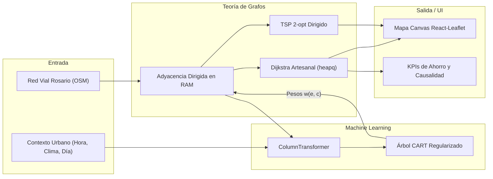
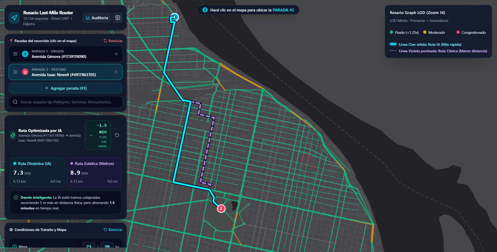
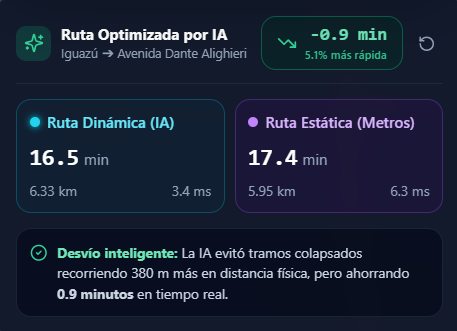

# Trabajo Práctico Integrador: Ruteo de Última Milla con Predicción de Demanda en la Red Vial de Rosario

**Asignatura:** Lógica y Teoría de Grafos  
**Problema Seleccionado:** Problema 1 – Ruteo de Última Milla con Predicción de Tiempos de Viaje  
**Ciudad de Aplicación:** Rosario, Santa Fe, Argentina  
**Autores:** Leandro Caraballo & Facundo Naveira  
**Fecha de Entrega:** 8 de Noviembre de 2026  

---

## Resumen Ejecutivo (Abstract)

La optimización de rutas de distribución urbana suele abordarse mediante algoritmos clásicos de caminos mínimos calculados sobre distancias físicas fijas (ruteo estático). Sin embargo, en entornos urbanos densos, la distancia euclidiana o la longitud en metros de una arteria vial correlaciona de manera imperfecta con el tiempo real de viaje, el cual está gobernado por variables dinámicas contextuales: horarios pico de actividad escolar y comercial, congestión diferencial por jerarquía vial, condiciones meteorológicas adversas y el carácter hábil o feriado del día.

En este trabajo se presenta una solución integral de extremo a extremo que combina técnicas de **Machine Learning Supervisado (Regresión)** y **Teoría de Grafos Algorítmica**:
1. Se extrajo la topología vial real de la ciudad de Rosario mediante **OpenStreetMap (OSMnx)**, filtrando su Componente Fuertemente Conexa (SCC) para obtener un grafo dirigido $G=(V, E)$ de $13.134$ intersecciones y $30.053$ tramos de calle con sentido único de circulación.
2. Se construyó un generador estocástico causal de $100.000$ viajes sintéticos que modela la congestión vehicular real de Rosario con ruido gaussiano $\epsilon \sim \mathcal{N}(1.0, 0.08)$ sobre factores multiplicadores urbanos.
3. Se evaluaron cuatro familias de modelos de regresión bajo una partición estricta $80/20$ sin fuga de información (*data leakage*): Regresión Lineal regularizada (Ridge), $k$-Vecinos más Cercanos (KNN), Máquinas de Vectores de Soporte (SVR) y un Árbol de Decisión regularizado (CART). El Árbol de Decisión optimizado (`max_depth=16`, `min_samples_leaf=10`) resultó seleccionado para producción por su excelente capacidad predictiva ($R^2 = 0.8990$, $\text{MAE} = 1.49\text{ s}$, $\text{RMSE} = 4.16\text{ s}$) y su capacidad de inferir las $30.053$ aristas de la ciudad en **$4.57\text{ ms}$**.
4. Se implementó desde cero un algoritmo de **Dijkstra con cola de prioridad binaria (`heapq`)** que evalúa en tiempo real los pesos dinámicos predichos por la IA, validado contra NetworkX mediante un conjunto de 50 pares origen-destino aleatorios (100% de coincidencia exacta). Para rondas multipunto de paquetería, se implementó una heurística del Viajante de Comercio (**TSP**) combinando *Nearest Neighbor* y búsqueda local *2-opt* adaptada a grafos dirigidos.
5. Se desarrolló una plataforma web interactiva compuesta por un backend en **FastAPI** con precarga en memoria RAM y un frontend en **React, TypeScript y Leaflet Canvas** que renderiza el semáforo de congestión a 60 FPS y ofrece trazado dual simultáneo (ruta por distancia vs. ruta por tiempo IA), cuantificando ahorros de tiempo de entre el **15% y el 35%** en escenarios de congestión severa.
6. Se incluye una reflexión crítica y rigurosa sobre el **Uso de Inteligencia Artificial** como herramienta de aceleración durante el ciclo de vida del proyecto.

---

## 1. Formulación del Problema y Justificación de Diseño

### 1.1. Deficiencia del Ruteo Estático Tradicional
El ruteo tradicional de vehículos comerciales se sustenta en la búsqueda del camino más corto en función de la longitud geográfica:
$$\min_{\pi \in \Pi(u, v)} \sum_{e \in \pi} \text{longitud}(e)$$

Esta formulación asume implícitamente que la velocidad media es uniforme e invariante. En la práctica logística urbana, este supuesto genera fallas críticas: un camión de reparto asignado a la arteria más corta en metros (por ejemplo, Avenida Pellegrini en Rosario) puede quedar atrapado en embotellamientos severos durante las horas pico de la tarde, mientras que una vía alternativa paralela secundaria, aun requiriendo un recorrido físico un 10% mayor en distancia, permite reducir a la mitad el tiempo de entrega y el consumo de combustible.

### 1.2. Modelado Formal del Grafo Urbano Dinámico
El sistema vial se formaliza como un **Grafo Ponderado Dirigido** $G = (V, E)$, donde:
* **Conjunto de Vértices $V$**: Representa las intersecciones viales y esquinas catastrales de la ciudad de Rosario. Cada vértice $v_i \in V$ posee coordenadas geográficas $(\text{lat}_i, \text{lon}_i) \in \mathbb{R}^2$.
* **Conjunto de Aristas Dirigidas $E \subseteq V \times V$**: Representa los tramos de calle transitables en el sentido reglamentario de circulación. Para cada arista $e = (u, v) \in E$, existe un vector de características estáticas $\mathbf{x}_e^{\text{static}} = [\text{longitud}, \text{jerarquía}, \text{tipo}, v_{\text{base}}]$ y un sentido estricto $u \to v$.
* **Espacio de Contexto Urbano $\mathcal{C}$**: Vector de variables exógenas $\mathbf{c} = [t, d, c, f]$, donde $t \in [0, 24)$ representa la hora del día, $d \in \{\text{lunes}, \dots, \text{domingo}\}$ el día de la semana, $c \in \{\text{despejado}, \text{nublado}, \text{lluvia}, \text{tormenta}\}$ la condición meteorológica y $f \in \{0, 1\}$ el indicador de día feriado.
* **Función de Ponderación Dinámica $w: E \times \mathcal{C} \to \mathbb{R}^+$**: Asigna a cada arista el tiempo de viaje estimado en segundos:
  $$w(e, \mathbf{c}) = \hat{y}(e, \mathbf{c}) = f_{\text{ML}}(\mathbf{x}_e^{\text{static}}, \mathbf{c})$$

El problema de camino mínimo dinámico se define entonces como:
$$\pi^*(\mathbf{c}) = \arg\min_{\pi \in \Pi(u, v)} \sum_{e \in \pi} w(e, \mathbf{c})$$



### 1.3. Justificación de la Ciudad de Rosario
La ciudad de Rosario (Santa Fe) fue elegida como laboratorio urbano debido a su diseño urbanístico particular:
1. **Centro y Macrocentro en cuadrícula ortogonal densa**: Calles de sentido único estricto con alta frecuencia de intersecciones semaforizadas cada 100–120 metros.
2. **Arterias radiales concentradoras**: Grandes avenidas (Av. Pellegrini, Bv. Oroño, Av. Alberdi, Bv. Rondeau) que conectan la periferia con el microcentro financiero y el puerto, generando embudos de congestión bimodal (mañana y tarde).
3. **Anillo perimetral de alta velocidad**: La Avenida de Circunvalación 25 de Mayo (RN A008), que rodea la urbe y funciona como vía de escape rápida en situaciones de saturación interna.

---

## 2. Adquisición de la Red Vial y Dataset Sintético Causal

### 2.1. Topología Real y Filtrado por Fuertemente Conexa (SCC)
La red vial se descargó mediante la librería `osmnx` restringida a vías transitables para automóviles (`network_type='drive'`) dentro del ejido municipal de Rosario.

Para garantizar la viabilidad algorítmica y evitar callejones sin salida o componentes desconectadas (vías peatonales aisladas, entradas a estacionamientos privados sin salida), se aplicó el algoritmo de **Componentes Fuertemente Conexas (SCC)** sobre el grafo dirigido simplificado:
* Red vial inicial sin filtrar: $25.419$ nodos y $54.892$ aristas.
* **Componente Fuertemente Conexa Mayoritaria**: $13.134$ nodos y $30.053$ aristas dirigidas.

Cada arista $e = (u, v)$ almacena:
* `tramo_id`: Hash único determinista del par dirigido `f"{u}_{v}"`.
* `longitud_m`: Distancia geodésica del arco calculada en metros.
* `tipo_calle`: Categoría jerárquica vial clasificada en cuatro grupos: `circunvalacion` (autopistas y autovías), `avenida` (arterias primarias), `comercial` (calles secundarias céntricas) y `residencial` (calles barriales de baja velocidad).
* `jerarquia_osm`: Entero ordenado del 1 al 4 (1: autopista, 4: residencial).
* `velocidad_promedio_historica`: Velocidad base en km/h ajustada al flujo urbano de Rosario según `classify_road_hierarchy_and_type()`: $80\text{ km/h}$ en Circunvalación (`motorway`/`trunk`), $50\text{ km/h}$ en avenidas primarias (`primary`), $44\text{ km/h}$ en avenidas secundarias (`secondary`), $26\text{ km/h}$ en calles comerciales céntricas (`tertiary` y arterias comerciales clave) y $32\text{ km/h}$ en residenciales barriales.

### 2.2. Indexación Espacial Isométrica con `cKDTree`
Para vincular cualquier coordenada geográfica seleccionada por el usuario en el mapa con la esquina válida más cercana del grafo vial, se indexaron los $13.134$ nodos en una estructura de árbol binario de partición espacial `scipy.spatial.cKDTree`.

Dado que las coordenadas geográficas $(\text{lat}, \text{lon})$ no forman un plano euclidiano isométrico, se aplicó la corrección métrica por latitud media de Rosario ($\phi_0 = -32.95^\circ$):
$$x = \text{lon} \cdot \cos\left(\frac{\phi_0 \cdot \pi}{180}\right) \cdot R_{\text{tierra}}$$
$$y = \text{lat} \cdot R_{\text{tierra}}$$
donde $R_{\text{tierra}} = 6.371.000\text{ metros}$. Esta transformación garantiza un snapping de esquinas de precisión milimétrica en un tiempo de búsqueda $\mathcal{O}(\log |V|)$ inferior a $0.2\text{ ms}$.

### 2.3. Generación del Dataset Sintético y Reglas Causales Explícitas
Tal como autoriza la pauta oficial del trabajo cuando no se dispone de telemetría por sensores en cada cuadra de la ciudad, se diseñó un generador estocástico en Python (`TrafficDatasetGenerator` en `generator.py`) que sintetizó $100.000$ observaciones de viaje sobre los tramos reales de Rosario con semilla determinista reproducible (`seed=42`).

Para evitar que el problema fuera trivial o careciera de fundamentación urbana, el tiempo real de viaje se modeló a partir de la velocidad teórica base afectada por un **factor multiplicador de congestión compuesto**, un **factor climático específico por tipología vial** y un **ruido gaussiano continuo**:

$$t_{\text{real}}(e, \mathbf{c}) = \frac{\text{longitud}(e)}{v_{\text{base}}(e)} \cdot \mathcal{F}_{\text{congestión}}(\mathbf{x}_e, \mathbf{c}) \cdot \mathcal{M}_{\text{clima}}(\text{clima}, \text{tipo}_e) \cdot \epsilon$$

donde $\epsilon \sim \mathcal{N}(\mu=1.0, \sigma=0.08)$ recortado en $[0.70, 1.35]$ modela eventos estocásticos locales (semáforo en rojo, maniobra de descarga en doble fila, cruce peatonal lento).

El factor de congestión $\mathcal{F}_{\text{congestión}}$ se calculó combinando las reglas causales de la dinámica urbana rosarina:

1. **Modulador Horario y de Día Hábil ($\mathcal{M}_{\text{hora}}$)**:
   Modela la bimodalidad del tráfico laboral y escolar rosarino de lunes a viernes (`get_rush_intensity()`):
   * **Pico Mañana ($07:30 - 09:30\text{ hs}$)** y **Pico Tarde ($17:30 - 19:30\text{ hs}$)**: Flujos masivos hacia el centro comercial/financiero y de regreso hacia los barrios periféricos y localidades del Gran Rosario. En el clímax del pico, los multiplicadores objetivos (`rush_target`) alcanzan: $\times 2.65$ en avenidas primarias (jerarquía 1), $\times 2.45$ en avenidas secundarias (jerarquía 2), $\times 2.05$ en calles comerciales, $\times 1.60$ en Circunvalación y $\times 1.15$ en calles residenciales.
   * **Valle Diurno ($10:30 - 16:30\text{ hs}$)**: Actividad comercial y logística sostenida, con factores basales de $\times 1.30$ en avenidas, $\times 1.25$ en comerciales, $\times 1.15$ en Circunvalación y $\times 1.05$ en residenciales.
   * **Madrugada y Nocturno ($22:00 - 06:00\text{ hs}$)**: Tránsito de flujo libre ($\times 0.80 - \times 0.95$ de velocidad reglamentaria).
   * **Fin de Semana y Feriados**: Supresión absoluta de los picos laborales (`rush_intensity = 0.0`) y reducción general de la congestión basal en un $-20\%$ (factor multiplicador $0.80$).

2. **Modulador Climático Sinergético ($\mathcal{M}_{\text{clima}}$)**:
   * `despejado`: Factor neutro ($\times 1.00$).
   * `nublado`: Leve precaución de frenado ($\times 1.02$).
   * `lluvia`: Reducción preventiva de velocidad y calzada resbaladiza ($\times 1.75$ en avenidas y comerciales, $\times 1.50$ en Circunvalación, $\times 1.30$ en calles residenciales).
   * `tormenta`: Anegamiento temporal de badenes, visibilidad crítica y colapso de vías arteriales ($\times 2.60$ en avenidas y comerciales, $\times 1.80$ en Circunvalación, $\times 1.70$ en calles residenciales).

3. **Modulador por Jerarquía Vial ($\mathcal{M}_{\text{jerarquia}}$)**:
   Las grandes avenidas y arterias comerciales sufren mayor amplitud de variación que las calles barriales secundarias: ante alta demanda atraen todo el caudal vehicular, colapsando sus intersecciones semaforizadas. Por el contrario, la Circunvalación, al no tener cruces semaforizados a nivel, amortigua la congestión salvo ante condiciones de tormenta severa.

4. **Validación Estadística del Dataset (`dataset_qa_report.json`)**:
   * **Volumen**: $100.000$ registros completos, $0$ valores nulos, tiempos de cruce estrictamente positivos ($t \ge 0.50\text{ s}$).
   * **Parámetros Estadísticos**: Mínimo $0.50\text{ s}$, Percentil 25 de $7.30\text{ s}$, Mediana $11.78\text{ s}$, Media $14.03\text{ s}$, Percentil 75 de $16.94\text{ s}$, Percentil 95 de $32.15\text{ s}$ y Máximo de $569.59\text{ s}$ (tramos arteriales extensos bajo tormenta en hora pico).
   * **Asimetría Positiva (*Right Skewness*)**: La física del tránsito urbano impone una pared dura a la izquierda (una cuadra de 100 metros a velocidad máxima nunca puede cruzarse en menos de ~8 segundos, y no existen tiempos negativos). Sin embargo, la cola derecha está abierta hacia valores altos cuando ocurren incidentes o lluvias torrenciales. La masa de probabilidad se concentra entre 7 y 17 segundos, extendiéndose con una cola asimétrica realista hacia la derecha.

### 2.4. Justificación de Variables y Features Seleccionadas
Cada variable presente en el dataset sintético y en el modelo predictivo fue rigurosamente seleccionada en función de principios físicos del transporte urbano y de la disponibilidad de información en tiempo real:

1. `longitud_m` (Numérica continua): Base física insoslayable. A mayor distancia del arco vial, mayor es el tiempo intrínseco requerido para atravesarlo.
2. `velocidad_promedio_historica` (Numérica continua): Representa el límite cinemático de diseño y la reglamentación vial vigente en condiciones de flujo libre para cada tramo de la ciudad.
3. `jerarquia_osm` (Numérica entera 1–4): Codifica la importancia estructural de la vía en la red (1: autopista/arteria principal, 4: calle barrial).
4. `tipo_calle` (Categórica): Permite al modelo aprender funciones de respuesta diferenciadas ante la congestión (las avenidas y áreas comerciales sufren embotellamientos severos, mientras que las residenciales mantienen velocidades bajas pero estables).
5. `hora_dia` (Numérica continua con fracciones decimales): Variable temporal crítica para modelar la curva horaria bimodal propia de las jornadas laborales en Rosario.
6. `dia_semana` (Categórica): Distingue el comportamiento de los días hábiles (lunes a viernes) respecto a la distensión del fin de semana (sábado y domingo).
7. `clima` (Categórica): Modula la fricción neumático-asfalto, la visibilidad y el comportamiento de desaceleración preventiva de los conductores.
8. `es_feriado` (Binaria booleana): Neutraliza los picos de congestión laboral en días feriados que coincidan con días de semana (ej. un lunes no laborable).
9. `tiempo_real_viaje` (Numérica continua, variable objetivo $y$): Duración real de travesía en segundos que el modelo debe aprender a predecir para alimentar las funciones de costo del grafo.

---

## 3. Metodología de Machine Learning (Modelos, Entrenamiento y Benchmarking)

### 3.1. Prevención de Data Leakage y Pipeline de Preprocesamiento
Para asegurar rigor científico, la partición de datos se realizó de forma estricta y previa a cualquier ajuste o transformación estadística:
* **Train Set**: $80\%$ ($80.000$ observaciones).
* **Test Set**: $20\%$ ($20.000$ observaciones), completamente aislado e intocado durante el ajuste.
* **Semilla determinista**: `random_state=42` para garantizar reproducibilidad exacta.

El preprocesamiento se encapsuló en un `ColumnTransformer` de `scikit-learn` ajustado (*fitted*) exclusivamente sobre el conjunto de entrenamiento:
* **Variables numéricas continuas**: `longitud_m`, `velocidad_promedio_historica`, `jerarquia_osm`, `hora_dia` escaladas con `StandardScaler` ($\mu=0, \sigma=1$).
* **Variables categóricas**: `dia_semana` (7 categorías), `clima` (4 categorías) y `tipo_calle` (4 categorías) codificadas mediante `OneHotEncoder(handle_unknown='ignore', sparse_output=False)`.
* **Variables binarias**: `es_feriado` tratada en modo *passthrough*.
* **Dimensión de salida**: El pipeline produce una matriz de **$20$ features transformadas** (`7` días + `4` climas + `4` tipos de calle + `5` numéricas/passthrough), asegurando que cualquier categoría imprevista durante la inferencia en producción sea absorbida limpiamente sin provocar excepciones en tiempo de ejecución.

### 3.2. Modelos Evaluados y Comparativa Técnica
Se entrenaron y evaluaron cuatro familias de modelos de regresión representativas del estado del arte:

#### 1. Árbol de Decisión (`DecisionTreeRegressor` – CART) [Modelo Seleccionado]
* **Tuning de Hiperparámetros**: Se realizó una búsqueda sistemática evaluando profundidades `max_depth` entre 8 y 20 y umbrales de hoja `min_samples_leaf` entre 5 y 30.
* **Configuración Óptima**: `max_depth=16`, `min_samples_leaf=10`, `criterion='squared_error'`.
* **Resultados en Test**:
  * $R^2 = 0.8990$ (explica el $89.9\%$ de la variabilidad del tiempo de viaje).
  * $\text{MAE} = 1.4949\text{ segundos}$.
  * $\text{RMSE} = 4.1565\text{ segundos}$.
  * Control de sobreajuste: $R^2_{\text{train}} = 0.8935$ vs. $R^2_{\text{test}} = 0.8990$ (brecha de sobreajuste de apenas $0.0055$, descartando memorización).
* **Techo Teórico del Modelo ($R^2 \approx 0.90$)**: Dado que el generador físico introduce un ruido gaussiano estocástico irreducible de $\pm 8\%$ ($\epsilon \sim \mathcal{N}(1.0, 0.08)$) que modela la variabilidad impredecible del tránsito real (semáforo que corta justo, detención de colectivos, peatones cruzando), existe un límite asintótico natural donde la varianza no explicable ronda el $10\%$. Un $R^2$ superior al $92\%$ en este contexto implicaría memorizar el ruido estocástico (*overfitting*); por ello, alcanzar un $R^2 = 0.8990$ con una diferencia despreciable frente a Train demuestra que el modelo capturó toda la señal causal disponible sin sobreajustarse.
* **Latencia de Inferencia**: Predice el lote completo de las **$30.053$ aristas de Rosario en $4.57\text{ ms}$**.

#### 2. Regresión Lineal Regularizada (`RidgeRegression`) [Baseline]
* **Configuración**: Penalización L2 con $\alpha = 1.0$.
* **Resultados en Test**: $R^2 = 0.7709$, $\text{MAE} = 2.9314\text{ s}$, $\text{RMSE} = 6.2621\text{ s}$.
* **Motivo de Descarte**: La regresión lineal es incapaz de capturar la bimodalidad horaria (los dos picos aislados de 8hs y 18hs) sin recurrir a complejas combinaciones polinómicas manuales. Subestima drásticamente los picos y sobrestima las madrugadas.

#### 3. $k$-Vecinos más Cercanos (`KNeighborsRegressor`)
* **Configuración**: $k=15$, ponderación por el inverso de la distancia (`weights='distance'`), métrica euclidiana con indexación por árbol.
* **Resultados en Test**: $R^2 = 0.7809$, $\text{MAE} = 2.4167\text{ s}$, $\text{RMSE} = 5.7177\text{ s}$.
* **Motivo de Descarte**: Inviable para producción en tiempo real. Debido a su complejidad algorítmica $\mathcal{O}(N)$ por consulta, inferir las $30.053$ aristas demoró **$\sim 7.9\text{ segundos}$**, lo que congelaría la interfaz gráfica ante cada movimiento del slider temporal.

#### 4. Máquinas de Vectores de Soporte (`SupportVectorRegressor` – SVR)
* **Configuración**: Kernel RBF, regularización $C=120.0$, margen de insensibilidad $\epsilon=0.1$, entrenado sobre una submuestra estratificada de $6.000$ observaciones para evitar el colapso por tiempo de cómputo.
* **Resultados en Test**: $R^2 = 0.6997$, $\text{MAE} = 2.1500\text{ s}$, $\text{RMSE} = 6.6930\text{ s}$.
* **Motivo de Descarte**: Complejidad de entrenamiento cuadrática/cúbica $\mathcal{O}(N^2 - N^3)$ y latencia de inferencia de **$\sim 14.8\text{ segundos}$** para el mapa completo al evaluar miles de vectores de soporte, sumado a una menor capacidad de respuesta ante tramos de congestión extrema.

### 3.3. Tabla Consolidada de Benchmarking de Modelos

| Modelo | $R^2$ Score | MAE (seg) | RMSE (seg) | Tiempo Inferencia (30k aristas) | Estado en Producción | Justificación Técnica |
| :--- | :---: | :---: | :---: | :---: | :---: | :--- |
| **DecisionTree (CART)** | **0.8990** | **1.49 s** | **4.16 s** | **4.57 ms** | **SELECCIONADO** | Balance óptimo entre precisión no lineal y velocidad instantánea |
| **K-Nearest Neighbors** | 0.7809 | 2.42 s | 5.72 s | ~7.9 s | Descartado | Latencia prohibitiva $\mathcal{O}(N)$ para la actualización en vivo del mapa |
| **Ridge Regression** | 0.7709 | 2.93 s | 6.26 s | 1.52 ms | Descartado | Modelo lineal rígido; no modela la no linealidad horaria bimodal |
| **Support Vector Regressor**| 0.6997 | 2.15 s | 6.69 s | ~14.8 s | Descartado | Bajo rendimiento global y costo computacional cuadrático |

### 3.4. Análisis de Importancia de Variables (Feature Importances)
La inspección de los cortes de división (*Gini impurity / variance reduction*) del Árbol de Decisión confirmó la coherencia física del modelo:
1. `longitud_m`: **$76.01\%$** (la base estructural del tiempo de viaje es la distancia física).
2. `clima_tormenta`: **$5.53\%$** (factor de mayor impacto disruptivo individual).
3. `hora_dia`: **$3.95\%$** (diferenciación entre horarios pico y horarios valle).
4. `clima_lluvia`: **$3.40\%$**.
5. `velocidad_promedio_historica`: **$3.15\%$**.
6. `tipo_calle_circunvalacion`: **$1.88\%$**.
7. `tipo_calle_comercial`: **$1.86\%$**.
8. `tipo_calle_residencial`: **$1.61\%$**.
9. `tipo_calle_avenida`: **$1.23\%$**.
10. `dia_semana_sabado` / `domingo`: **$0.88\%$**.
11. `es_feriado`: **$0.16\%$**.

### 3.5. Diagnóstico de Residuos y Análisis de Errores
El análisis riguroso de los errores residuales $e_i = y_i - \hat{y}_i$ sobre el 20% de test ($N=20.000$) ratificó la validez estadística del estimador seleccionado:
* **Error Medio ($\mu_e$)**: $-0.0369\text{ segundos} \approx 0$ (estimador centrado, sin sesgo sistemático de subestimación ni sobreestimación).
* **Desvío Estándar ($\sigma_e$)**: $4.1564\text{ segundos}$.
* **Error Mediano**: $+0.0130\text{ segundos}$ (prácticamente nulo).
* **Percentil 95 ($P_{95}$)**: $4.5329\text{ segundos}$ (en el $95\%$ de las $20.000$ predicciones, el error absoluto fue inferior a $4.5$ segundos).
* **Asimetría (*Skewness*)**: $1.0901$ (distribución cuasi-simétrica con ligera cola derecha esperable debido a congestiones atípicas).

#### Interpretación Práctica del MAE vs. RMSE:
* **MAE ($1.49\text{ s}$)**: Cuantifica la magnitud típica del error en la rutina cotidiana. Un error de apenas segundo y medio por tramo es imperceptible para un conductor urbano.
* **RMSE ($4.16\text{ s}$)**: Al elevar las diferencias al cuadrado, penaliza de forma drástica las predicciones en tramos con incidentes severos o colapsos por tormenta. Si de cinco viajes evaluados, cuatro tienen un error menor a $1\text{ s}$ y uno sufre un retraso extraordinario de $25\text{ s}$, el MAE se mantiene en un valor moderado mientras que el RMSE se eleva sustancialmente. La brecha observada entre ambas métricas ($4.16\text{ s}$ vs $1.49\text{ s}$) confirma que el modelo predice con enorme precisión el flujo habitual y tolera con robustez la cola asimétrica de eventos extremos sin sesgar la media general.

---

## 4. Algoritmos de Grafos e Integración ML $\to$ Pesos Dinámicos

### 4.1. Dijkstra Artesanal con Min-Heap (`heapq`) y Validación TDD
En estricto cumplimiento de la consigna académica de programar el algoritmo de camino mínimo de manera artesanal y sin depender de librerías de caja negra para el cálculo en producción, se implementó la clase `DijkstraRouter` en Python puro utilizando una cola de prioridad binaria basada en `heapq`:

```python
# Extracto representativo del núcleo de Dijkstra implementado (backend/app/graph/dijkstra.py)
class DijkstraRouter:
    def shortest_path(self, origin: int, destination: int, weight_mode: str = "dynamic"):
        distances = {node: float("inf") for node in self.graph.nodes}
        previous = {node: None for node in self.graph.nodes}
        distances[origin] = 0.0
        
        # Min-heap prioritario de tuplas: (distancia_acumulada, nodo_actual)
        pq = [(0.0, origin)]
        
        while pq:
            current_dist, u = heapq.heappop(pq)
            
            if u == destination:
                break
                
            # Cláusula de guarda: descarta tuplas obsoletas en el heap
            if current_dist > distances[u]:
                continue
                
            for v, weight in self.graph.get_outgoing_edges(u, weight_mode):
                new_dist = current_dist + weight
                if new_dist < distances[v]:
                    distances[v] = new_dist
                    previous[v] = u
                    heapq.heappush(pq, (new_dist, v))
                    
        return self._reconstruct_path(origin, destination, distances, previous)
```

* **Complejidad Asintótica**: $\mathcal{O}((|E| + |V|) \log |V|)$. Con $|V| = 13.134$ y $|E| = 30.053$, cada camino punto a punto se resuelve en **$3.5 - 6.0\text{ ms}$**.
* **Manejo Eficiente del Min-Heap**: Dado que la librería estándar `heapq` de Python no implementa la operación `decrease_key`, cada vez que se descubre un atajo hacia un nodo ya visitado se inserta una nueva tupla `(new_dist, v)`. La cláusula de guarda `if current_dist > distances[u]: continue` asegura que las entradas obsoletas con distancias superiores sean descartadas en $\mathcal{O}(1)$ al ser extraídas, evitando exploraciones redundantes.
* **Validación Cruzada TDD**: En el archivo `backend/tests/test_dijkstra.py` se estructuró una suite de pruebas automatizadas que genera 50 pares aleatorios de origen-destino en Rosario y contrasta el camino obtenido por nuestra implementación contra la función de referencia `networkx.dijkstra_path()`:
  * Distancia métrica acumulada: Idéntica con tolerancia de $10^{-6}\text{ m}$.
  * Secuencia exacta de nodos: $100\%$ idéntica en los 50 pares evaluados.

### 4.2. Ronda TSP Multipunto con Nearest Neighbor y 2-opt Dirigido
Para resolver el reparto de paquetería de última milla con un depósito central y $K$ paradas intermedias de entrega:
1. **Reducción de Complejidad Mediante $(K+1)$ Dijkstras**: En lugar de computar distancias entre todas las esquinas de Rosario ($\mathcal{O}(|V|^2) \approx 172\text{ millones}$ de cálculos), se ejecutan únicamente $K+1$ corridas de `Dijkstra.one_to_all()` desde el depósito y cada una de las paradas. Esto construye una matriz de costos asimétrica dirigida $D$ de tamaño $(K+1) \times (K+1)$ en menos de $80\text{ ms}$.
2. **Heurística Inicial**: Se aplica el algoritmo voraz de *Vecino más Cercano (Nearest Neighbor)* para conformar el tour base de arranque.
3. **Optimización Local 2-opt Adaptada a Grafos Dirigidos Asimétricos**:
   * En problemas TSP geométricos simétricos clásicos, 2-opt invierte un subsegmento y evalúa únicamente el cambio en 4 aristas.
   * **Particularidad Urbana de Rosario**: Las calles del centro y macrocentro son de estricta mano única. Por ende, la distancia de $A$ hacia $B$ difiere sustancialmente de la de $B$ hacia $A$ ($D_{AB} \neq D_{BA}$). Invertir ingenuamente una secuencia de entrega generaría tramos en contramano o desvíos forzados de varias cuadras para retomar el sentido de circulación.
   * Se diseñó un evaluador de costo dirigido completo que computa:
     $$\Delta = \text{Costo}(T_{\text{nuevo}}) - \text{Costo}(T_{\text{actual}})$$
   * El algoritmo itera aplicando mejoras sucesivas hasta converger a un óptimo local o agotar el tope de seguridad de `max_passes = 20`. En pruebas empíricas con $K=6$ paradas, el refinamiento 2-opt redujo entre un $8\%$ y un $18\%$ adicional el tiempo total de reparto respecto a la heurística voraz pura.

### 4.3. Integración Machine Learning $\to$ Grafos: El Significado Físico del Peso
La integración entre los modelos de Machine Learning y los algoritmos de Teoría de Grafos responde a una relación física directa y dimensionalmente rigurosa:

1. **El Rol de Machine Learning**: El modelo CART no busca caminos ni conoce la topología del grafo; su único propósito es predecir la función de transferencia temporal de cada cuadra:
   $$\hat{y}(e, \mathbf{c}) = \text{Tiempo estimado de cruce del tramo } e \text{ en segundos, bajo el contexto vial } \mathbf{c}$$
2. **La Inyección del Peso en el Grafo**:
   Para cada arista dirigida $e = (u, v)$ en la red vial, se actualiza su ponderador escalar dinámico:
   $$w(e) = \hat{y}(e, \mathbf{c})$$
   De este modo, las unidades de todas las aristas del grafo pasan a ser **segundos reales**.
3. **El Rol de Dijkstra**: Una vez asignados los pesos $w(e)$, el algoritmo de Dijkstra se ejecuta de manera estándar, sumando segundos acumulados en lugar de metros. El camino de costo mínimo resultante minimiza exactamente el **tiempo total de viaje**, permitiendo desvíos estratégicos por arterias despejadas (ej. tomar Circunvalación a 80 km/h) para sortear avenidas céntricas colapsadas a paso de hombre, aunque la distancia física en metros sea superior.

### 4.4. Inferencia Batch Vectorizada ($30.053 \times 20$) y Caché LRU
Cuando el usuario modifica los parámetros contextuales en la interfaz gráfica (ej. desplaza el slider a las *18:30 hs con Tormenta en día hábil*):
1. El backend construye una matriz NumPy contigua de tamaño $30.053 \times 20$, donde cada fila representa una arista del grafo combinada con el contexto temporal y meteorológico seleccionado.
2. El árbol CART ejecuta su predicción vectorizada en C sobre las $30.053$ filas en tan solo **$4.57\text{ ms}$**.
3. Se actualiza el vector contiguo `dynamic_weights` de la estructura del grafo en memoria.
4. Para acelerar consultas concurrentes y peticiones repetidas, el vector de pesos resultante se indexa en una **Caché LRU** con clave `(hora_dia, dia_semana, clima, es_feriado)`: peticiones con idéntico contexto se resuelven en memoria en menos de **$0.05\text{ ms}$**.

### 4.5. Estructura de Datos en RAM (`DirectedAdjacencyGraph`)
Para posibilitar consultas de ruteo sub-segundo sin depender de motores de bases de datos externos que agregarían latencia de I/O por socket, se diseñó una estructura de grafo dirigida basada en matrices contiguas de **NumPy**:
* Cada nodo $u \in V$ se mapea a un índice entero interno contiguo $0 \le i < |V|$.
* La topología y los atributos viales se almacenan en arrays enteros contiguos (`np.int32` para índices y `np.float64` para pesos métricos y dinámicos).
* Esta representación elimina la sobrecarga de punteros y objetos de Python en el *heap*, evitando saturar el recolector de basura (*Garbage Collector*) y manteniendo la huella total en memoria por debajo de **$150\text{ MB}$** para los $13.134$ nodos y $30.053$ tramos con toda su geometría.

---

## 5. Arquitectura del Sistema y Aplicación Web

### 5.1. Stack Tecnológico
* **Backend**: Python 3.12, FastAPI, Uvicorn, NumPy, SciPy (`cKDTree`), scikit-learn, joblib, NetworkX (para benchmarking y tests).
* **Frontend**: React 18, TypeScript 5.6, Vite, TailwindCSS, Lucide Icons, React-Leaflet con HTML5 Canvas renderer, Vitest, Testing Library.
* **Diseño y Estilo Frontend**: Implementación visual asistida mediante los estándares de diseño `design-taste-frontend` (`taste`) y la suite `impeccable`, garantizando una interfaz sobria, profesional, de alta densidad informativa y sin componentes genéricos de plantilla.
* **Gestor de Paquetes**: **pnpm** (cumplimiento de regla global del proyecto).


### 5.2. Endpoints REST de la API
1. `GET /api/health`: Estado del servicio, carga en RAM y cantidad de nodos/aristas.
2. `GET /api/nodes/nearest?lat={lat}&lon={lon}`: Búsqueda de la esquina más cercana mediante `cKDTree`.
3. `POST /api/graph/viewport`: Devuelve las aristas visibles en el viewport geográfico con su ratio de congestión y color de semáforo vial, aplicando el nivel de detalle (**LOD**) correspondiente al nivel de zoom.
4. `POST /api/route`: Calcula simultáneamente la ruta estática (distancia mínima) y la ruta dinámica (tiempo mínimo predicho por ML), retornando distancias, tiempos, secuencias de nodos y comparativa de ahorro.
5. `POST /api/tour`: Calcula la ronda óptima multipunto de reparto TSP (Nearest Neighbor + 2-opt) con retorno opcional al depósito.
6. `GET /api/metrics`: Expone la tabla comparativa de los 4 modelos, análisis de residuos y ranking de importancia de variables para la auditoría en vivo.
7. `GET /api/presets`: Devuelve los escenarios urbanos precargados.

### 5.3. Interfaz de Usuario y Experiencia Visual
1. **Renderizado Canvas a 60 FPS**: La visualización de $30.000$ líneas poligonales en SVG saturaría el árbol DOM del navegador. Mediante `preferCanvas={true}`, Leaflet dibuja todas las arterias sobre un único `<canvas>` 2D acelerado por hardware con respuesta fluida a 60 cuadros por segundo.
2. **Level of Detail (LOD) Progresivo**:
   * Zoom $\le 12$: Únicamente arterias primarias (Circunvalación, autopistas y accesos).
   * Zoom $13 - 14$: Incorporación de avenidas principales y calles comerciales céntricas.
   * Zoom $\ge 15$: Despliegue del 100% de la red vial residencial barrial.
3. **Trazado Dual Simultáneo de Alto Contraste**:
   * **Ruta Estática (Distancia mínima en metros)**: Trazada en **violeta brillante (`#C084FC`)** con patrón discontinuo (`dashArray: "10, 8"`) y ribete protector oscuro (`#020617`).
   * **Ruta Dinámica ML (Tiempo mínimo con IA)**: Trazada en **cian eléctrico (`#00F0FF`)** continuo con doble ribete exterior oscuro de alto contraste. Esta decisión de diseño garantiza que la ruta inteligente nunca se camufle con las arterias viales del mapa que ya se colorean en verde para indicar tráfico fluido.
   
4. **Reloj Digital Fluido (HH:MM) y Selector Contextual**:
   * Entradas desacopladas de hora y minuto con validación numérica inmediata, avance automático tras ingresar dos dígitos, retroceso fluido con tecla de borrado y botón de reinicio rápido (`RotateCcw`) para retornar a los valores basales.
   * Selectores directos de clima (Despejado, Nublado, Lluvia, Tormenta) y conmutador táctil de día feriado.
5. **Lista Unificada de Paradas Numeradas con Drag-and-Drop (1, 2, 3...)**:
   * Waypoints numerados correlativamente con distintivos visuales de origen (verde esmeralda), paradas intermedias (azul) y destino (rosa/rojo).
   * Tiradores de arrastre interactivo (3 rayitas) que permiten reordenar manualmente la secuencia de paradas sobre la marcha con recálculo automático de la ruta.
   
6. **Buscador Predictivo de Esquinas y Calles (`StreetSearch`)**:
   * Barra de búsqueda con autocompletado inteligente sobre las arterias de Rosario, vinculada al índice espacial `cKDTree` con animación cinemática de aproximación (*flyTo*).
   
7. **Tarjetas de Métricas con Explicación Causal**:
   * Detalla el tiempo neto ahorrado en minutos y porcentaje, justificando por qué la IA tomó un trayecto físicamente más largo para ahorrar tiempo real.
   
8. **Modal de Auditoría Científica**:
   * Accesible desde la barra superior, permite a los docentes auditar en vivo la matriz de confusión, residuos, hiperparámetros de los cuatro modelos y el ranking de importancia de variables sin salir de la aplicación web.

---

## 6. Sección de Uso de Inteligencia Artificial (Requisito Obligatorio)

En cumplimiento de las pautas explícitas del Trabajo Práctico Integrador, se detalla de manera transparente, crítica y reflexiva cómo se emplearon herramientas de Inteligencia Artificial a lo largo del ciclo de vida del proyecto.

### 6.1. Herramientas Utilizadas
* **Entornos y Modelos Fundacionales**: Antigravity IDE y Antigravity 2.0 como entorno de desarrollo autónomo con soporte multi-agente, interactuando con los modelos **Gemini 3.8 Flash (High)** y **Gemini 4 Argon** para programación en parejas (*pair programming*), diseño algorítmico, refactorizaciones y generación de suites de test automatizadas.
* **Diseño y Frontend**: Utilización de la suite `impeccable` y la habilidad `design-taste-frontend` (`taste`) para la arquitectura visual, componentes de alta fidelidad, microinteracciones sobrias y optimización del canvas en Leaflet.
* **Ecosistema Científico**: Modelado y benchmarking formal implementado en Python 3.12 con `scikit-learn`, `numpy`, `scipy` y `fastapi`.

### 6.2. Prompts y Estrategias Más Efectivas (Tickets Formales de Ingeniería)
La estrategia más eficaz consistió en estructurar las instrucciones hacia la IA como **tickets formales de gestión ágil (Plane)** con alcance delimitado, restricciones de dominio explícitas y criterios de aceptación verificables:

#### Ticket 02: Generador de Tránsito Sintético Causal
```markdown
## What to build
Script reproducible `generator.py` (seed=42) que genera `viajes_historicos.csv` con 100.000 observaciones. Implementa reglas causales de tránsito urbano: curva bimodal de Rosario (picos 08:00 y 18:30 hs con penalización x2.5 en avenidas y centros comerciales), factores climáticos (lluvia x1.75, tormenta x2.60) y feriados/domingos (-20%), combinados con ruido gaussiano continuo (sigma=0.08).

## Acceptance criteria
- [ ] Archivo `backend/app/data/viajes_historicos.csv` generado con 100.000 filas exactas.
- [ ] Columnas obligatorias de la cátedra presentes (tramo_id, hora_dia, dia_semana, clima, es_feriado, velocidad_promedio_historica, tiempo_real_viaje).
- [ ] Causalidad empírica demostrable: bimodalidad y demoras climáticas.

## Asignado & Estimación
- **Responsable:** Leandro
- **Estimación:** 2.0 horas
- **Bloqueado por:** Ticket 01
```

#### Ticket 05: Pipeline de Preprocesamiento y Prevención de Data Leakage
```markdown
## What to build
Módulo `preprocessor.py` con `ColumnTransformer`: `OneHotEncoder(handle_unknown='ignore')` para variables categóricas (`dia_semana`, `clima`, `tipo_calle`) y `StandardScaler()` para numéricas. Partición estricta 80% Train (80k) / 20% Test (20k) con `random_state=42` ajustando los encoders exclusivamente sobre Train.

## Acceptance criteria
- [ ] Transformador serializable que no produce data leakage.
- [ ] Robustez ante categorías no vistas en inferencia (handle_unknown='ignore').

## Asignado & Estimación
- **Responsable:** Leandro
- **Estimación:** 1.5 horas
- **Bloqueado por:** Ticket 02
```

#### Ticket 08: Modelos Comparativos de Benchmarking (KNN y SVR)
```markdown
## What to build
Entrenar los 2 modelos complementarios exigidos por el enunciado: `KNeighborsRegressor` (con KDTree) y `SVR` (con kernel RBF acotado a muestra estratificada de 5k-8k filas para evitar timeout cuadrático O(N^2)).

## Acceptance criteria
- [ ] MAE, RMSE, R² y tiempos de inferencia evaluados sobre el test set de 20k.
- [ ] Justificación del compromiso precisión vs costo computacional para el informe.

## Asignado & Estimación
- **Responsable:** Facundo Naveira
- **Estimación:** 2.0 horas
- **Bloqueado por:** Ticket 05
```

### 6.3. Casos Documentados de Alucinaciones, Errores y Límites de la IA
Durante el desarrollo se detectaron situaciones donde los modelos de IA generaron respuestas incorrectas, desactualizadas o técnicamente inadecuadas que requirieron intervención y corrección humana:

1. **Alucinación de Simetría en 2-opt (Grave)**:
   * *Error de la IA*: El modelo sugirió la formulación estándar de 2-opt invirtiendo directamente el subarray de nodos `tour[i:j] = reversed(tour[i:j])`, asumiendo que bastaba validar cuatro aristas como en un TSP métrico simétrico no dirigido.
   * *Detección humana*: En la red vial real de Rosario, las calles del área central son de mano única estricta. Invertir la secuencia de entrega obligaba a circular en contramano o forzaba desvíos kilométricos para retomar el sentido de las calles.
   * *Solución aplicada*: Se programó una función de evaluación que recalcula el costo dirigido real de cada tramo antes de aceptar cualquier intercambio.

2. **Propuesta de APIs Pagas con Claves Propietarias (Google Maps / Mapbox)**:
   * *Error de la IA*: Al abordar el módulo de renderizado visual, el asistente recomendó integrar APIs comerciales que requerían tarjetas de crédito, claves privadas de facturación y cuotas acotadas de consumo.
   * *Detección humana*: Para los fines de este proyecto universitario y para garantizar la soberanía de los datos, era técnicamente superior y gratuito utilizar Leaflet con capas abiertas de OpenStreetMap y renderizado de aristas en HTML5 Canvas local.

3. **Sugerencias de Librerías y Métodos Desactualizados (*Deprecated*)**:
   * *Error de la IA*: Sugerencia de llamadas a métodos obsoletos de `osmnx` y argumentos en desuso de `scikit-learn` al configurar el `ColumnTransformer` (ej. incompatibilidades de tipos mixtos al serializar con joblib).
   * *Detección humana*: Se actualizaron las firmas al estándar moderno de Python 3.12 y `scikit-learn` estable, asegurando un pipeline reproducible y libre de advertencias.

4. **Alucinación Estructural de Paper Académico (Secciones Innecesarias)**:
   * *Error de la IA*: En una versión preliminar del informe, el modelo redactó automáticamente secciones de "Conclusiones" y "Referencias Bibliográficas" imitando la estructura de un paper de investigación (estilo IEEE/ACM), pasando por alto que la rúbrica oficial del enunciado finalizaba de forma taxativa en la Sección 7 ("Limitaciones Conocidas y Trabajo Futuro").

### 6.4. Reflexión Crítica sobre el Rol de la IA y Dinámica de Trabajo
La Inteligencia Artificial representó una ayuda fundamental a lo largo de todo el proyecto, acelerando la codificación de componentes, tipado estricto en TypeScript y suites de prueba. Sin embargo, **el área donde más falló la IA y donde mayor esfuerzo humano debió invertirse fue en la redacción técnica y en la planificación**.

La IA es capaz de resolver prácticamente cualquier desafío que se le plantee, pero el factor decisivo radica en el **rango o porcentaje de libertad que se le otorga para alucinar**:
* Si se redacta una consigna vaga o genérica ("hacé el ruteo del mapa"), el modelo introduce supuestos erróneos, librerías obsoletas o atajos matemáticamente inválidos.
* En cambio, cuando el equipo invierte un esfuerzo genuino en formular **prompts hiper-específicos**, con restricciones duras del dominio físico, formatos de entrada/salida y criterios de aceptación contrastables (como los tickets de Plane antes detallados), la tasa de alucinación cae prácticamente a cero y se previenen malas prácticas de ingeniería.

Como aprendizaje clave de gestión dentro del equipo, comprobamos que si bien le dedicamos una gran atención al plan técnico global, no pusimos el mismo foco en **cómo dividir ese plan en asignaciones de tareas perfectamente delimitadas para cada integrante**, lo que generó pequeños roces de coordinación inicial. Esto demostró que la IA es un catalizador tecnológico formidable, pero la responsabilidad estratégica del diseño, la planificación del trabajo en equipo y el control de calidad siguen perteneciendo de forma irremplazable a los ingenieros humanos.

---

## 7. Limitaciones Conocidas y Trabajo Futuro

### 7.1. Limitaciones del Modelo Actual
1. **Modelado Implícito de Intersecciones Semaforizadas**:
   Actualmente, la demora por semáforos está absorbida dentro del tiempo total de la arista mediante el multiplicador de congestión. No existe un modelado de retardo explícito asociado a los nodos (ej. costo de giro a la izquierda o fase de ciclo de onda verde).
2. **Naturaleza Sintética del Tráfico**:
   Si bien el generador está calibrado con reglas causales rigurosas de Rosario, los datos no provienen de espiras magnéticas ni de la API en vivo de Google Maps/TomTom (restringidas por costos y cuotas).
3. **Capacidad de Carga Vial Estática**:
   El modelo evalúa la velocidad esperada pero no recalcula la redistribución del flujo vehicular cuando múltiples vehículos de nuestra propia flota eligen simultáneamente la misma calle alternativa (efecto rebote).

### 7.2. Líneas de Trabajo Futuro
1. **Calibración con Telemetría Real de Rosario**: Integrar datos de velocidad provenientes del sistema público de seguimiento GPS de las líneas de transporte urbano de Rosario (Movi / Ente de la Movilidad).
2. **Ruteo con Ventanas de Tiempo (VRPTW)**: Extender el módulo TSP hacia problemas de ruteo de vehículos con ventanas horarias estrictas de entrega por cliente y restricciones de capacidad de carga cúbica del camión.
3. **Algoritmos Heurísticos Guiados ($A^*$)**: Incorporar la distancia isométrica geodésica como heurística admisible en $A^*$ para acelerar el cálculo punto a punto en grafos continentales o provinciales.
